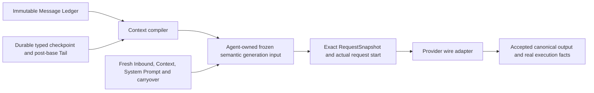

# Context Engine, immutable history and model projections

Canonical conversation facts, model-visible context and real execution have
separate owners. Compaction changes a historical context projection; it never
creates a canonical summary message or edits conversation facts.



## Ownership

| Owner | Authority |
| --- | --- |
| Canonical History | Real committed User, Assistant and Tool facts, with physical Message and Tool-call occurrence identities |
| Context Engine | Historical selection compilation, structural/native replay validation, token accounting and compaction planning |
| CompactionResources | Cut-bounded, read-only canonical/trajectory/lifecycle, Journal, checkpoint, frozen request and settled Artifact access; admitted model budgets and supervised summary capability |
| Durable Store | Immutable checkpoint bodies, projection activations/head, fencing/CAS, atomic local completion and operation receipts |
| Agent Loop | Current frozen logical-generation input, cancellation grants, actual starts, independent recovery/retry budgets and tool settlement |
| Provider adapters | Wire encoding, native reasoning replay and accepted-output continuation rules |
| Event Journal | Actual execution facts; projected calls/results never become executions |
| RequestSnapshot | Exact provider-neutral input of one actual started request |
| Runtime Client and clients | Canonical execution trajectory and separately labelled projected context/request detail |

The ordinary canonical working-set cache can append real committed identities.
It cannot replace a span, create a summary identity, or select historical model
context independently of the checkpoint compiler. Normal head reads resolve
checkpoint Original identities and post-base Tail identities within finite
bounds; they do not replay or hydrate the complete old Ledger.

## Four different boundaries

1. **Resource Read Cut** freezes source Ledger, Journal, Transcript and projection
   activation coordinates together. Reads after capture are short-lived and return
   detached owned values. A completion committed after the Journal cut remains
   invisible to that operation's lifecycle queries.
2. **Checkpoint Base Ledger Frontier B** is a complete inclusion/exclusion
   decision for eligible canonical history through B. Provenance references and
   the last retained Original do not move this frontier.
3. **Checkpoint Activation** is a separate monotonic timeline coordinate. Two
   activations can occur at the same Ledger frontier and remain distinct boundaries.
4. **Request History Cut** freezes checkpoint identity/activation/base and the
   request's pre-start Ledger frontier. Default Tail is strictly `(B, request L]`.

A checkpoint at L100 that excludes M96–M100 never revives those messages through
Tail. A later M101 remains eligible. Unrelated Journal appends do not change a
candidate's head, immutable dependencies or execution fence.

## Typed checkpoints and occurrence identity

A checkpoint contains ordered Original references and materialized Derived
messages. An Original is scoped to a conversation and complete immutable-body
SHA-256 digest. A Derived has typed User, Assistant or Tool content and scoped
canonical/checkpoint provenance, without a canonical MessageId. Text, Reasoning,
ToolCall, ToolResult, Refusal and supported media retain their typed representation.
Every historical Derived item must name at least one canonical or parent-checkpoint
source. A transformation label alone is not provenance. The compiler enforces this
universal historical rule and scope/self-reference checks; durable authority validates
immutable bodies, digests, eligibility and dependency ordering. Parent-only summaries
are permitted. This rule does not apply to request-only synthetic material.

These identity domains are distinct:

- Physical canonical ToolCall: accepted Assistant MessageId and canonical block index.
- Checkpoint occurrence: CheckpointId, item index and projected block index.
- Actual-request occurrence: new RequestId, item index and request block index.
- Provider wire correlation: the provider's string label.

Repeated wire strings do not identify one historical execution. The compiler
validates Original/Original, Original/Derived, Derived/Original and Derived/Derived
call/result pairs, complete batches, explicit reordered coordinates and physical
sources. Ambiguous associations, orphan results and split batches fail. Snapshots
freeze the resulting actual-request association map, reidentified on a new request.
No ToolExecution event, duration, usage or execution statistic comes from a
projected call/result.

## Resource bounds

Default CompactionResources pages are at most64 items/4MiB, individual source
records at most1MiB, and cumulative reads at most8192 items/16MiB. SQLite checks
raw sizes before allocating or decoding oversized records. Checkpoint content,
Derived bodies and inline provenance have independent finite compiler budgets.
Serialization accounting writes to bounded sinks rather than allocating another
source-sized byte buffer. Resource cuts hold no database transaction while a
summary provider is awaited. Algorithms may mutate detached working copies only.

## Durable commit and recovery

Allocate CompactionOperationId before its associated Started fact. A candidate
fingerprint describes checkpoint content; it is separate from an actual semantic
request fingerprint. One immediate transaction validates the expected head,
existing execution owner/fence, immutable dependencies and trusted metadata, then
persists content, activation/head, diagnostics, the actual local CompactionCompleted
fact and an idempotent receipt. Every transaction-stage failure rolls back all of
those writes.

The same operation and candidate recover the same historical receipt. Reusing
an operation with different candidate content conflicts. Uncertain commit outcomes
are resolved by operation lookup, without another summary invocation. A confirmed
successful commit cannot be followed by a contradictory CompactionFailed fact.
Installation reads the current durable head under the current owner; an old receipt
cannot install an old checkpoint over a newer head. Unreconciled installation stops
execution before a provider start.

Cancellation and checkpoint authorization share a short grant gate. Cancellation
before grant prevents commit; cancellation after grant cannot undo the authorized
transaction. Actual model-request start arbitration remains a separate existing
Agent owner gate. Neither path adds a durable execution state machine.

## Default Summary

The default policy preserves reserve/output accounting, compaction thresholds,
keep-recent behavior, summary-input reservation/shrinks, structured Markdown/XML
and deterministic file-operation sections. It selects only complete historical
prefixes. Fresh Inbound, current-generation Context and carryover anchors remain
core-owned protected inputs.

Planning indexes canonical positions, discovers complete Tool batches and renders the
authorized historical transcript once. Eligible boundaries already respect
`must_cover_through`, Fresh Inbound, accepted Context and request-only carryover
anchors. Each queried boundary is priced using the complete Summary request,
complete retained primary request with fixed core inputs and Summary output
reservation, and whole recent-history suffix. A selected boundary is never accepted
from an approximate per-message token sum. Generated Checkpoint and complete actual
primary input are validated again after Summary output exists, before commit.

`DefaultTokenEstimator` supplies a narrow monotone compaction guarantee. Its price
is `ceil(serialized semantic JSON bytes / 4)`: array brackets, separators and
independent item encodings have nonnegative byte costs; removing a prefix cannot
increase the primary or recent suffix price. Appending rendered transcript text
cannot decrease the escaped JSON byte count of the fixed Summary wrapper. Tools,
prompt and core overlays remain fixed. Rounding preserves monotonicity, but does
**not** justify adding separately rounded per-message estimates. Production media
preparation freezes authorized resources before advertising this proof, as described
below. An arbitrary estimator never inherits a guarantee from media preparation.

Tool items are priced from the Tool Plane's existing bounded model-facing projection,
not serialized `ToolExecutionResult`. The neutral semantic view joins text-only parts
with the projection's canonical separators and retains ordered text/image parts for
media. Visible status and managed-output continuation remain included. Duration,
exit code, Workflow identity, delivery cards, non-visible Artifact metadata and
truncated tails remain canonical execution facts and contribute no input cost.
Tool semantic fingerprints use this same normalized content; text-only identities
remain unchanged, while media identities include the actual bounded ordered parts.
Unsupported Tool content is never treated as zero cost and fails adapter admission.

This normalization remains message-local: each surviving item has fixed bounded
bytes after frozen media materialization. Whole-array JSON accounting, fixed core
inputs and nonnegative immutable image charges therefore retain the monotone proof.
No per-message rounding, candidate-time I/O or approximate-fit substitution is used.

For a guaranteed estimator, binary partition queries find the intersection of the
Summary-fit initial interval and primary-fit final interval. Whole recent prices
identify the keep-recent initial interval. Selection preserves the established
policy: the largest feasible boundary retaining `keep_recent_tokens`; if none
retains that target, the earliest feasible boundary. Empty fit intersection proves
`CannotFit`. The selected candidate's complete prices are checked explicitly.
With N boundaries and B input/transcript bytes, preparation is O(N log N + B),
queried materialization is O(B log N), and memory is O(N + B), including bounded
core overlays. At most `3 ceil(log2(N+1)) + 1` distinct candidates are priced, with
three complete estimator calls each; cached prices do not retain copied bodies.
Estimator implementations remain responsible for their own query complexity.

### Frozen production media accounting

The Agent owns a `model::media::MediaSnapshot` through its Context Engine for the
current logical generation. It captures committed history before proactive planning
and extends the same immutable resource authority for accepted staged Context.
Existing upload resolutions and image bytes are never resampled. The next logical
generation clears that capture; transient retries retain the exact frozen request.
Idle/manual Compaction uses an operation-scoped capture in the shared pipeline,
without starting a primary request or invoking dynamic contributors.

Session-owned upload resolution runs once for newly needed references. Capture
validates the returned identity set and absolute paths, rejects duplicate/unresolved
results, and budgets paths and expanded text before rendering. ArtifactStore owns
bounded, conversation-scoped PNG reads and validation. Only the union of images
selected by the historical-only and complete-primary accounting views is captured:
at most 32 unique images, each at most 256 KiB. The two views are necessary because
fixed staged Context can occupy primary image slots absent from keep-recent pricing.
Pure candidate materialization performs no artifact/catalog I/O.

Both prices and actual request staging call the same materializer: apply the existing
upload renderer, then the existing image policy, then mark semantically changed
Originals as scoped request-local Derived values. This corrects the previous mixed
wrapper order (images before uploads), which could merge an omission into upload
body text differently from the actual request. Final staging copies only selected
image bytes into RequestSnapshot; post-materialization complete-request validation
and native continuation reconciliation still precede ModelRequestStarted.

The monotonicity proof covers each transform independently:

- Frozen upload rendering is message-local; deleting a prefix removes complete
  rendered messages and preserves every surviving rendered message byte-for-byte.
  Upload rendering preserves the order of image occurrences.
- Text-only image omission is message-local and uses the same bounded reference text
  as request staging.
- For newest-16 retention, an omitted occurrence has at least sixteen newer image
  occurrences. A historical prefix deletion that retains that occurrence also
  retains all its newer occurrences. It therefore cannot promote the omitted image.
  A retained occurrence remains retained. Fixed Context and carryover preserve the
  surviving order, and a protected before-message anchor cannot be retired.
- Validated PNG dimensions give immutable nonnegative per-occurrence charges.
  Removing a prefix can only remove charges, including repeated artifact references.

Thus every surviving semantic JSON item and image charge is fixed separately in
both primary and recent views. The DefaultTokenEstimator proof extends to their
whole-request prices, including mixed and already-Derived media. Summary transcript
rendering remains the existing one-pass textual rendering of raw historical items;
it is not replaced by a simplified media request or a rounded per-message sum.
Binary interval search is complete for these supported production cases.

Capture admits at most 8,192 input items and 1,024 upload identities, at most 16 MiB
of path/name bytes, and at most 16 MiB of bounded expanded upload-bearing User text
per view. Escaping uses the renderer’s exact byte-length mapping before allocation; a bounded
per-reference header allowance covers delimiters. Upload lookup uses an indexed map.
Preparation is linear in input bytes plus reference indexing; pure hypothetical
materialization remains O(B log N), with O(B + N + I + U) retained memory for bounded
image bytes I and upload paths U. Each required unique image is read once per
capture lifetime, and upload resolution is never invoked by candidate queries.
Resources no longer selected by either view are released when capture is extended.

Missing/corrupt selected images, unavailable Session uploads, invalid paths,
changed capture ownership or excess budgets fail explicitly before Summary/request
admission. Intentionally omitted images require no payload read. Cancellation is
observed before/after resource resolution, between image reads, before/after capture,
and at the existing planning yields; a synchronous bounded read/PNG decode itself
is not preempted. Cancellation and commit/request authorization remain Agent-owned.

For an arbitrary estimator, descending exact queries inspect at most 64 boundaries.
A validated preferred fit is conclusive because every larger boundary has already
been excluded. Without such a fit, exhaustive evaluation chooses the earliest
feasible fallback or proves `CannotFit`. If eligible boundaries remain unexamined,
`SearchIncomplete` reports unknown feasibility or preference; it never claims
infeasibility. This path bounds materialization to O(64 B), independent of N.
An arbitrary non-monotone estimator can make any unseen boundary uniquely feasible;
no finite sampling shortcut can establish otherwise. Incomplete planning starts no
Summary, commits no Checkpoint, and settles once as a runtime compaction failure,
even when recovery followed a real provider overflow. It does not retry planning,
classify itself as provider overflow, or alter unrelated recovery budgets.

Agent-owned cancellation is observed at cooperative yields during indexing/rendering,
before/after each complete estimate, and before Summary admission. Individual
synchronous estimates finish before the next observation; no new execution owner or
request-start arbitration is introduced. The existing Summary shrink loop remains
separately bounded.

The summary is a Derived User checkpoint item. Retained history remains ordered
Original/Derived items. Trusted cumulative read/modified-file metadata comes from
canonical native ToolCall facts and earlier immutable checkpoint metadata;
summary prose cannot invent that authority. Consuming an earlier Summary retains
its scoped checkpoint provenance.

Manual, proactive and overflow recovery share this pipeline. Manual compaction
creates no Agent Turn, primary request snapshot/start or dynamic-contributor
invocation. Its summary service call is isolated from primary execution. Successful
default Summary compaction clears active primary continuation and recompiles the
complete new projection; continuation-preservation optimization is absent.

## Exact frozen input and composed retries

The Agent Loop retains the latest immutable semantic input of a logical generation.
An authorized semantic correction or compaction advances that version. A transient
retry uses the latest version, with new request, publication and provisional-output
identities and equivalent content/wire associations:

```text
Q1(I1) -> overflow -> authorized P2 -> freeze I2
Q2(I2) -> transient failure -> Q3(I2)

Q1(I1) -> authorized correction -> freeze I2
Q2(I2) -> overflow -> authorized compaction -> freeze I3
Q3(I3) -> transient failure -> Q4(I3), including corrective material
```

Retry and recovery budgets remain independent and share the actual-request ordinal.
Semantic fingerprints do not deduplicate starts, provider usage or execution facts.
For Context K, Q1 records Visible=[K], Introduced=[K]; a genuinely new Q2 records
Visible=[K], Introduced=[] with K appearing once. Recovery of the exact same Q1
receipt retains Q1's original introduction records.

Content-changing image downgrade and upload-path rendering produce request-local
Derived messages with scoped provenance. Dynamic materialization is complete
before final token validation, snapshot commit and dispatch. Changed semantic
content never silently keeps an Original identity. System/tool/workflow/correction
material stays with the frozen input version through all later transient retries.

RequestSnapshot stores ordered immutable Original dependencies, complete Derived
bodies, request-only context, selected image bytes, invocation, continuation source,
Tool associations and semantic fingerprint. Reconstruction performs keyed immutable
reads only; it never reruns compaction, contributors, upload mappings, image selection
or dynamic discovery. Exact reconstruction, current resendability and generation
reproducibility are different capabilities.

## Native reasoning and continuation

Chat Completions retains configured reasoning replay semantics. Anthropic requires
complete signed/redacted thinking units; Responses requires complete accepted
native encrypted output bundles and valid stored coverage. Adapters never invent
signatures, encrypted state, reasoning items or protocol dialects.

Continuation names the actual accepted Assistant output of the prior actual
request. An arbitrary Assistant occurrence in that request's input cannot own
continuation. Clearing the active pointer does not erase immutable native source
facts, and stateless replay remains subject to independent native validation.

## Historical timeline, lineage and archives

Clone/Fork copies historical checkpoint boundaries and immutable dependency closure
into destination-owned scopes. Source Origin Activation and Destination Installation
are separate identities. Both `(L100,P1)` and `(L100,P2)` survive cloning; selecting
mapped P1 or P2 in a later fork retains the corresponding semantics, including
after cloning again. Source deletion cannot remove a correctly copied dependency
set. Expected missing/corrupt checkpoint dependencies fail explicitly.

Inherited checkpoints create no destination CompactionCompleted execution event.
Current projection and frozen request detail expose bounded Original/Derived
provenance separately from canonical trajectory. UI adjacency never supplies an
execution owner or Tool relationship.

Session inspection archives include a projection activation stream. Lossy request
or native replay exports explicitly report non-reconstructibility. Incomplete old
snapshot bytes do not invalidate an independently complete active checkpoint;
missing active dependencies block preparation. See [session-archive.md](session-archive.md).

## 2. Unified Context Assembly

There is one rustX-owned assembly contract in src/context/assembly.rs.
Native observations and certified-extension observations enter the same
validation and ordering pipeline:

~~~text
claimed inbound (already canonical; not extension-controlled)
    ↓
ContributorInputSnapshot
    ↓
native observations + certified extension contributors
    ↓
typed transient ContextProposal values
    ↓
await all bounded contributor work
    ↓
rustX validation, provenance, semantic lanes, deterministic ordering
    ↓
AcceptedContext
    ↓
Agent Loop admission
    ↓
canonical User context facts + RequestSnapshot
    (including the frozen Effective System Prompt)
~~~

### Finite contributor input

ContributorInputSnapshot is an immutable, finite value containing exactly
the current invocation facts exposed by the implementation:

- attempt_id, conversation_id, and the model turn;
- the exact surface_revision and finite active surface_ids;
- the finite claimed_inbound message batch;
- canonical workspace_root;
- immutable attempt capability_revision.

Contributors receive no ConversationState, ledger/surface mutator,
registry, capability lease, current model configuration, clock, provider
adapter, or arbitrary runtime handle. The runtime samples native facts before
assembly. If a future contributor needs a bounded cancellable read, it must
be added as an explicitly owned immutable seam; accepted output is still
frozen before admission.

### Proposals and trust boundaries

The request-time contributor proposal kind is:

- UserMessageProposal { content };

Certified-extension System Sections are registered as immutable resource
values in the owning Runtime Resource Snapshot. They are not dynamically
proposed by an extension on every request.

Proposals are transient bounded User context, not commits. They contain no
MessageId, trusted producer identity, surface operation, or provider payload.
Native domain proposals may include typed metadata and producer-local receipts;
assembly validates those against the identity bound by frozen composition.
Certified-extension proposals receive their provenance from registration.

`NativeContextInput` contains only resource-frozen System Sections: workspace
instructions, Skill guidance, core identity, and agent profile. Goal and Agent
Status are ordinary registered `ContextContributor` implementations. Their
domains own capture and model-facing rendering; assembly never serializes Goal.
See [native contribution lifecycle](native-context-contributions.md).

The logical extension identity is stable and serializable. An optional
attestation/package/content generation is recorded separately in
ContributorGeneration and does not affect ordering. Thus a package upgrade
that preserves its logical key cannot reorder unrelated extensions.
Contributor invocation order is canonical logical identity order, never
registration order, discovery timing, an address, a handle, or an index.

### Semantic lanes

The finite user lanes are ordered as:

1. ClaimedInbound — already claimed canonical input, never extension-owned;
2. RuntimeToolObservation — the lane of the **native runtime observation
   owner** (`NativeContextContributor::RuntimeToolObservation`);
   native-reserved, never extension-owned;
3. ExtensionEnvironment — multiple certified extensions;
4. TaskData — native domain contributors, including Agent Status and Goal.

Lanes express placement semantics, not one lane per extension. Within a lane,
order is stable producer identity, deferred/request-time phase, authoritative
originating-fact order, then contributor-local proposal order.

The native observation lane sits directly after claimed inbound because that
owner's facts describe what the environment just did for the *preceding* tool
batch, while every later lane describes the *current* request.

### Timing is not ownership

A lane expresses common placement semantics; producer identity names its owner.
Neither derives from when the fact became eligible. The
Issue #56 `ToolResultObserver` seam establishes eligibility — a proposal it
returns is *deferred*, admitted at the next primary step rather than this one —
and eligibility is a lifecycle-timing property owned by the Agent Loop.

Semantic ownership stays here. Every deferred proposal reaches assembly
carrying the producer reference the Agent Loop stamped from its observer's
*binding*. Assembly resolves that reference to an authoritative registration
(next section) and only then derives the lane, the `UserSource`, and the
`ContextKind` — through the same table it applies to that owner's request-time
proposals:

| producer identity | lane | `UserSource` | `ContextKind` |
| --- | --- | --- | --- |
| `Native(RuntimeToolObservation)` | `RuntimeToolObservation` | `Runtime` | `RuntimeToolObservation` |
| `Native(AgentStatus)` | `TaskData` | `Runtime` | `AgentStatus` |
| `CertifiedExtension(key)` | `ExtensionEnvironment` | `Extension { key }` | `ExtensionEnvironment` |

So a certified extension that produces deferred post-tool context keeps its
extension identity, its extension provenance, and its own lane. There is no
rule converting post-tool proposals into native runtime context.

`Native(WorkspaceInstructions)` and `Native(SkillGuidance)` are intentionally
absent from this User-context table. They publish only the
`SystemSectionLane::WorkspaceInstructions` and
`SystemSectionLane::NativeCapabilityGuidance` sections respectively. Neither
has a `UserSource`, `ContextKind`, User message, Ledger entry, or Surface
identity. Their bytes come from the attempt's immutable Runtime Resource
Snapshot; Skill catalog text contains routing metadata only.

### Registration is the only semantic admission authority

A deferred proposal does not arrive with a trusted identity. It arrives with a
`DeferredContextProducer`, which is a **reference**:

- `Native { identity }` — a closed native identity resolved against the frozen
  composition registration, including the built-in runtime observation owner;
- `CertifiedExtension { identity }` — a logical key resolved against its certified
  registration. Neither reference is an independent provenance authority.

`ContextAssembly::assemble` resolves the reference against the extensions
installed by native composition or `ContextAssembly::register_extension` — the
single registration table where a producer becomes trusted — and uses that registration's own
`ContributorGeneration`, attestation included. An unknown key is rejected with
`ContextAssemblyError::UnregisteredContributor`: no lane, no
`UserSource::Extension`, no synthesized generation, and no partially admitted
batch. A lifecycle observer therefore cannot become a second extension
registry by naming an extension, and a certified extension that only produces
deferred context still gets its authoritative generation without contributing
anything at request time.

### Deferred proposals are User context

Deferred and request-time proposals use the same bounded `ContextProposal`
vocabulary. Neither supports dynamic System Sections. `ToolResultObserver`
observes settled facts and returns proposals, never canonical history writes,
tool replacement, or model execution.

Inside one `(lane, contributor)` bucket, a deferred fact precedes the same
owner's request-time fact, because it describes the batch that precedes the
step. Beyond that the order is the Agent Loop's staging order, which is
`(canonical ToolCall batch position, producer identity, proposal FIFO)`;
physical tool completion timing and observer registration order never reach
it. Owners with no lane for a proposed kind (`CoreSystemIdentity` and
`AgentProfile` publish no User context) are rejected rather than relaned.

The deferred batch is bounded by `MAX_DEFERRED_CONTEXT_PROPOSALS` over all
producers together; the Agent Loop enforces the same bound earlier, at its
observer transaction boundary, together with the established
`MAX_PROPOSALS_PER_CONTRIBUTOR` bound on each single observation. There is no
separate deferred-only proposal constant.

The finite system-section lanes are ordered as:

1. CoreRuntimeIdentity — native-reserved, single owner;
2. AgentProfile — native-reserved, single owner;
3. WorkspaceInstructions — native-reserved, single owner;
4. CertifiedExtension — multiple extensions, sorted by logical identity;
5. NativeCapabilityGuidance — native-reserved.

There is no arbitrary numeric priority. A second single-owner semantic owner
is rejected; last-wins, first-wins, priority-wins, registration order, and
package discovery order are not conflict policies. The manifest is derived
from the same lane, native-owner, provenance, and proposal-kind constants
used by assembly validation.

## 4. Effective System Prompt

`ModelRequest.effective_system_prompt` is the one provider-neutral System
authority. RustX renders it with `render_effective_system_prompt` from:

1. native CoreRuntimeIdentity sections;
2. native AgentProfile sections;
3. frozen project/workspace instructions;
4. certified-extension sections in canonical logical identity order;
5. native capability guidance owned by rustX, including the
   request-time Skill catalog when the immutable snapshot has visible Skills.

The section family is the SystemSectionLane contract. Extensions can
contribute only the certified-extension lane; they cannot claim or shadow a
native section and cannot replace the entire prompt. RustX owns the final
section ordering, separators, and rendered string. The exact rendered string
is frozen by value in every RequestSnapshot; reconstruction never reruns
section contributors, rediscover Skills, or reads current configuration.
Compaction transforms only historical model context, so it cannot remove
or suppress project instructions or the Skill catalog section. Provider
adapters translate this value into their protocol's System/instructions field
when non-empty and emit no System authority when it is empty; they never scan
historical messages.


## Deterministic owner tests

Tests follow `tests/README.md`: structural/compiler contracts at Context,
transactions and receipts at SQLite, retries at Agent, lineage at Session, protocol
at contracts, and presentation at each client. Channel/watch/barrier hooks force
cancellation and fault interleavings at actual grant/transaction/start boundaries.
No sleep or probabilistic scheduling constitutes a race proof. Validation evidence
and the Section13 mapping are recorded in [issue-466-implementation-status.md](issue-466-implementation-status.md).

## Projection inspection pagination

WebUI history is keyed by Session and accumulated in activation order, deduplicated
by activation identity without replacing earlier immutable records. Detail pages
accumulate by checkpoint item occurrence only within the selected Checkpoint.
Session unmount invalidates pending request tokens; selection changes supersede
pending detail tokens. Responses and errors from obsolete requests cannot publish.
Each pagination stream allows one current page request, preserves prior pages on
failure, and carries the latest authoritative cursor until exhaustion. Inspection
continues to create no execution facts or provider requests.

Final request admission belongs to Agent execution and Provider Adapters. Preliminary
staging may select compaction and reduce carryover; it cannot admit a request. Every
final semantic input undergoes complete adapter translation/replay preflight after
media materialization and continuation coverage reconciliation, before exact Snapshot
freeze and cancellation-versus-start arbitration. Ordinary transient retries reuse
that validated frozen input without contributor, upload, image or preflight resampling.
