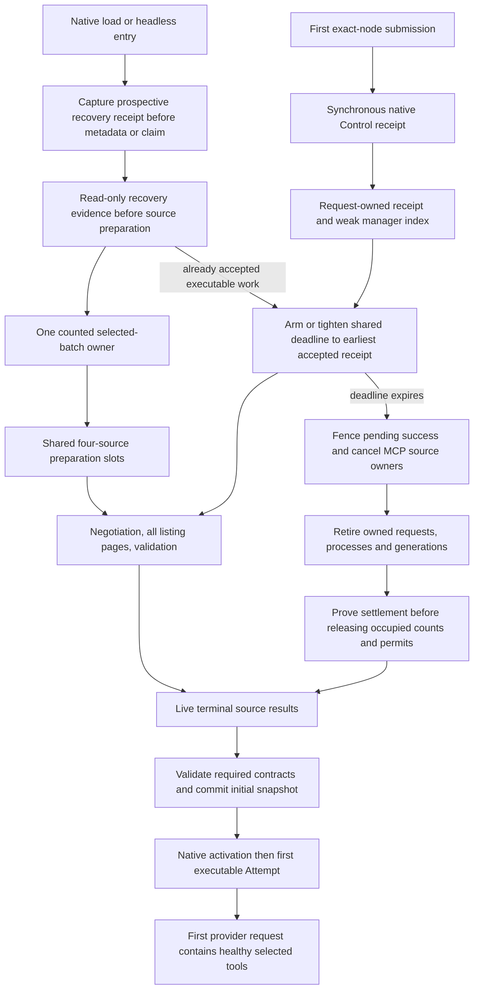
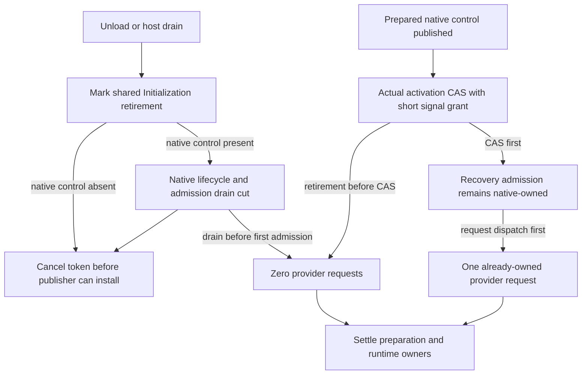
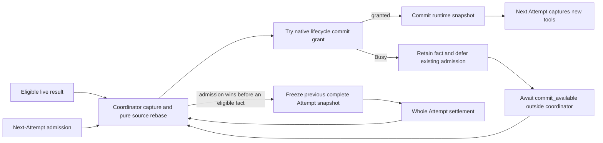

# Issue #499: live MCP readiness with a submission-triggered wait

PR [#503](https://github.com/Caismis/rustX/pull/503) implements the owner-approved
replacement for the original #499 cache/grace design. The first executable
Attempt waits for the finite selected MCP startup batch's validated live results
or explicit terminal outcomes. Healthy tools are present in its first provider
request. Successful supported runtime catalog/recovery updates publish
automatically at the native safe boundary.

The original one-second grace, process-wide metadata hints, cached-tool
advertisement and manual startup-readiness adoption are superseded. Their design
and measurements remain [historical evidence](superseded-grace-design.md), not
acceptance criteria for this revision.

## Superseding owner-review corrections

Owner review of `e8a446fd37dfa469df4b5553f00d1581fccc2cdd` found three
production gaps after the earlier source approval. The native fingerprint
`64e9a3768527922cae763bbade69b7774602097f75fdbd1c7207d9dbada95b46`,
its approval receipt, earlier measurement files and completed validation below
are historical checkpoints. That review missed loss of profile-composed Agent controls; its
approval does not verify these corrections or the final PR head.

- Web submission intent now uses the same existing `admitSessionOperation` proof
  and reserved-dispatch-slot authorization as attachment. A missing or canonically
  replaced Workspace root refuses intent before native initialization, including
  when a valid MCP configuration and peer remain behind the replacement.
  Removing a Workspace registration still preserves configured-root authorization;
  the [existing exact-root policy](../open-workspace.md) is unchanged.
- Runtime catalog reconciliation preserves the complete adopted capability base,
  including all five profile-composed Agent controls. Those controls stay outside
  the ordinary selectable Tool catalog and do not depend on an enabled Workflow.
  Unchanged observations remain semantic no-ops, while active Attempts keep their
  complete frozen inventory and the next Attempt receives eligible new schemas.
- Frozen-tool validation retains the exact transport, epoch and tools returned by
  discovery. One invocation may establish one transport; if that transport dies
  after discovery, that invocation fails without replacing it again or sending
  `tools/call`. A later independently owned invocation may reconnect.

The TUI clean-build prerequisite and fixture cleanup repair in `f7cae82a0` remains
separate. The shared browser gate now also supplies its mandatory cancellation
signal and retains cancellation diagnostics and cleanup. New source regressions
are mapped below. Earlier correction-specific measurement and independent-review
receipts are linked below; fresh full validation and final FULL CI/Merge
verification belong to the [PR validation record](https://github.com/Caismis/rustX/pull/503)
until their new receipts are recorded here. Earlier passing runs are not substituted for them.

## Superseding submission-admission capacity correction

A later P2 review found that six ordinary `session/attach` RPCs waiting for MCP
readiness could occupy every ordinary position. Fresh `session/settings` needed
to authorize `session/submissionIntent` then waited behind those attachments,
preventing the native submission receipt from arming their wait budget. Moving
only the final intent to a control lane did not make its preparation reachable.

Native and the shared Web/TUI method policy now reserve **two metadata
positions** for only `session/read` and `session/settings`, both inert native
catalog reads. Fresh exact-node/cwd resolution remains available under six held
attachments; no authorization cache is introduced. The connection has **18**
positions: six ordinary, eight observation, two metadata and two control. Native
host admission is bounded by `max_connections * 18`, with noncontrol work limited
to `max_connections * 16`. Ready-input fairness is bounded by 18 response
completions plus 19 observations. The Web metadata lane shares the existing
64-request pending bound and retains a 30-second response deadline starting at
actual send, not while queued. TUI retains its existing response-clock policy.
Product Host scope and exact-root classification are still fresh at final dispatch.

The five new real-client/Host saturation cases below pass in the focused
`workspace-host-admission.test.ts` run (**12 passed, 0 failed** for the complete
file). The completed current-source checks and fresh 24-row measurements are
recorded below; full native/browser reruns and final CI remain pending. Commit `06c55eb9ce3f9892aa70d92dea7273f2fac3df59`, its review2
receipts and CI #1516 are earlier checkpoints; none verifies this capacity fix.
Current head/base/merge FULL and Merge verification remain recorded in the
[PR validation record](https://github.com/Caismis/rustX/pull/503).

## Startup policy and its clock

```toml
[mcp_startup_policy]
wait_timeout_ms = 15000
```

The default is **15,000 milliseconds**. CFG3 applies User/Workspace precedence to
the complete object: an omitted Workspace object leaves the User object in force;
an empty Workspace object restores the product default. Positive integer values
and checked monotonic deadline construction are required. Native authoring,
schema, resolution, provenance and source round trips preserve the field. Existing
editors do not need a new settings control.

Preparation without an accepted executable intent can begin before the first
submission, with **no owner-level elapsed-time startup deadline**. Native captures
the first submission intent's monotonic timestamp before any MCP-dependent load, attach, claim or readiness
wait. It arms exactly one absolute clock:

```text
deadline = submission_received_at + effective_wait_timeout
```

With no accepted executable intent, sixty seconds of preparation before Send
consumes none of that budget. Remaining queueing, negotiation, every tool page and readiness validation share the clock.
Concurrent waiters, phase transitions, ownership handoff, UI reconnect and
revalidation cannot reset or extend it. Already-ready sources introduce no
artificial delay. No selected MCP means no MCP wait or I/O. Later ordinary
messages on the same initialization do not acquire another initial wait. A cold
Conversation load after unload creates a new physical initialization, whose first
accepted submission needing preparation owns its budget; this adds no artificial
15-second delay per message. Model response timeouts, Tool execution deadlines
and protocol negotiation/fallback remain separate.

Existing durable Pending Inbox work or a safe `ContinueAdoptedTurn` is already an
accepted executable intent. Native load/headless entry captures a prospective
monotonic recovery receipt before metadata resolution or allocation claim. Before
source preparation, including selected managed Python, read-only existing
`RecoveryEvidence`/`RecoveryPlan` recognition determines whether that receipt
applies. Empty or completed history alone leaves the clock unarmed. Recognition
neither reconciles history nor moves the existing recovery/replay owner.

An earlier recovery receipt discovered after a later Send can only tighten the
same absolute clock. For a load at T0 and Send at T10, learning the accepted
recovery intent changes the provisional T25 deadline to T15; it never supplies
another budget or extends a wait. The active waiter observes that earlier
absolute deadline. Persisted wall-clock age is not a monotonic submission receipt.

Only the finite native Root/enabled-Workflow demand closure starts work. Merely
configuring a source or naming an inert child profile performs no initialization.
The existing four-source preparation bound and independent outcomes remain. A
fresh Conversation owns its physical connections; metadata observed in a previous
Conversation does not prove live readiness. Ready means successful negotiation,
complete paginated discovery, canonical registration validation and a stable
invalidation epoch. A valid empty catalog succeeds. Pending discovery cannot prove
that an exact selected name is absent; live-confirmed missing names and duplicate
identities retain ordinary validation.

An optional Root source's terminal failure/timeout is reported honestly while
native tools and healthy siblings remain usable. Required Workflow and frozen
child contracts remain strict. This policy is shared by Web, TUI and headless
composition, without depending on polling or attachment count. TUI retains early
asynchronous attachment and an editable surface. App Server records
`session/submissionIntent` before waiting for attachment; headless
`compose_and_submit` captures native intent before composition.

Later frozen-child realization retains its separate **60-second** supervised
startup-handshake limit, starting when the parent awaits `Ready`. It covers the
child's remaining composition, selected MCP negotiation, complete discovery and
strict validation; expiry rolls back the owned launch through physical settlement.
The Root/enabled-Workflow submission batch uses the configurable policy above.

## Initialization and retirement ownership



Cancellation or expiry is terminal for that initialization attempt. A late
response cannot revive it as Ready. Cancellation initiates retirement; it does
not prove process exit or HTTP-request release. Returning from initialization can
include the existing physical-settlement latency; the readiness deadline does
not promise that the whole submission returns in exactly 15 seconds. Dropped caller/RPC futures likewise
do not prove cleanup. Existing settlement owners retain physical accounting,
occupied permits and bounded diagnostic evidence until their strongest honest
settlement boundary. Drain fences late activation and settles retained candidates
and generations as well as active preparation. A later explicit retry is a new
owned initialization, not revival of the expired one.

Conversation unload/drain cancellation is separate from an optional source's
startup timeout. A shared generic `Initialization` belongs to the flight,
resident and exactly bound accepted receipts. Its short control mutex protects
only `retirement_requested` and the prepared native control, installed before
activation. It never spans SQL, activation or native retirement.



With prepared native control, retirement closes the existing native
`PreparationRollback`/drain boundary before publishing the cancellation token,
even if activation already won. Both the pre-CAS and post-CAS/pre-admission cuts
therefore prevent provider dispatch. A request that won admission earlier remains
owned through ordinary native shutdown. The short CAS grant ends before recovery
SQL and Attempt admission; native retirement runs after releasing host, registry
and initialization-control locks. Every Host `begin_drain` recollects current
initialization owners, permanently fences new initialization before the first
inventory and returns only after issuing their native admission fence. A receipt
is bound to one exact non-retiring initialization; it cannot follow a failed
owner onto a retry or resurrect a later unloaded incarnation.

## Runtime readiness and next-Attempt admission

Successful supported retry/reconnect/catalog reconciliation is runtime state
under the adopted source authority. Finite pending facts are captured before
next-Attempt admission under the native coordinator. Publication uses a
nonblocking native lifecycle commit grant: Busy retains the result and defers the
existing admission, while the worker awaits the actual `commit_available`
frontier outside the coordinator lock. It does not park controls behind an
independent background ownership mutex, poll an advisory eligibility stream or
create another input. Newer eligible facts are recaptured before resuming that
admission, so an older pending candidate cannot consume a later catalog update.



An active Attempt keeps its entire registry, executors and declarations through
all model steps. Detached executions and children likewise retain their frozen
owners; they do not own publication of future runtime facts. Idle publication
requires no inbound input, provider/auxiliary request, user retry or history
mutation. Tool changes report actual request-shape/cache impact. No-op results
produce no semantic publication or model request. Successful but unpublished
refresh generations remain owned by drain, including behind an active Attempt.

Eligibility uses a continuous per-source authorization token plus exact binding,
selection and physical owner. Changing X → Y → X cannot revive X's earlier
completion, even for an Unavailable source with no connection. Unrelated
Todo/context/model changes, a sibling's new binding and unchanged no-op commits
do not revoke another continuously authorized source. At publication, the pure
coordinator rebase retains an eligible fresh retry R, current adopted non-MCP
resources and newer sibling S facts without another handshake or listing. The
complete adopted base includes all five profile-composed Agent controls, outside
the ordinary selectable catalog even with no enabled Workflow. A source that has
itself advanced cannot be overwritten by an older capture.

Authored instructions, source definitions/selection, environment, model/context
and other pending intent remain separate. Publication cannot adopt them. Captured
pending intent is retained and its candidates revalidated against the current
baseline, including newer model selection. Rebase uses the currently adopted
Todo, context, environment and model rather than restoring their captured old
values. Source authorization changes supersede stale success and stale failure.

A failed explicit refresh retains the committed last-good snapshot and a
source-scoped, chronological diagnostic. An older queued success, unrelated
sibling success or context-only adoption cannot clear a newer explicit failure.
A genuinely newer successful explicit whole-batch refresh clears it. Failure
creates no endless automatic retry scheduler; ordinary authored adoption and
explicit retry retain their existing separate owners.

The current connection's validated catalog snapshot and discovery coalescing are
retained. Tool execution still checks the frozen exact name, description and full
schema against the live generation. Validation uses discovery's exact retained
transport, epoch and tools; losing that transport cannot trigger a second
connection establishment within the same invocation. Invalidation during
discovery or between validation and enqueue must win before the external-effect
frontier. No ambiguous
dispatched effect is replayed. The rmcp response cache remains disabled on every
transport generation, including reconnects; failed refresh never becomes stale
successful discovery. MRTR, Tasks, progress routing, generation leases and
terminal uniqueness/terminal-last keep their existing owners.

## Regression map

The following map identifies deterministic regression coverage in source,
including the superseding owner-review corrections. It is
not a claim that an earlier revision's green run verifies this revision. Final
execution results must be recorded against the final source/head below.

The startup owner cases live in [coordinator/startup.rs](../../src/capabilities/coordinator/startup.rs)
and [startup/http_tests.rs](../../src/capabilities/coordinator/startup/http_tests.rs).
Native receipt, recovery and publication cases live in
[mcp_readiness.rs](../../tests/scripted/app_server/configuration/mcp_readiness.rs);
headless cases use [composition/tests.rs](../../src/local_runtime/composition/tests.rs).

| Contract | Current regression |
| --- | --- |
| Pre-submission time consumes no budget; readiness ten seconds after receipt reaches the first request | `preparation_time_does_not_consume_first_submission_wait`, `first_submission_joins_unarmed_early_preparation_with_one_native_budget` |
| No selected MCP takes no clock time, preparation slot or physical initialization | `no_selected_mcp_needs_neither_a_budget_nor_a_preparation_slot` |
| A completed live preparation adds no wait when the first submission arms its budget | `completed_live_preparation_needs_no_wait_when_submission_arms_budget` |
| Public headless submission captures time before composition and emits no early provider request | `headless_first_submission_waits_ten_seconds_for_exact_selected_tools`, `first_request_waits_for_complete_selected_mcp_discovery` |
| FIFO receipt ownership survives an unpolled first RPC and a later waiter | `first_unpolled_submission_receipt_keeps_its_absolute_deadline` |
| Pending Inbox and safe adopted-turn recovery use the earlier native load receipt, even if recognized after Send | `durable_recovery_receipt_precedes_later_send_and_bounds_initial_mcp`, `earlier_captured_recovery_receipt_tightens_a_running_wait_without_extension` |
| Exact-node receipt precedes a blocked catalog lookup; another node cannot arm that source | `accepted_exact_node_clock_precedes_blocked_catalog_lookup`, `submission_intent_requires_an_exact_node` |
| Cold attachment overtaking receipt lookup consumes the accepted clock before starting MCP | `cold_attach_consumes_an_accepted_receipt_before_starting_mcp` |
| Queued work, stale revalidation and handoff retain the absolute clock | `queue_and_waiter_handoff_cannot_restart_the_first_submission_clock`, `configured_source_queue_expires_without_starting_physical_work`, `stale_initial_capture_retry_does_not_restart_the_first_submission_clock`, `submission_clock_survives_unload_handoff_and_competing_attach_claims` |
| Expiry fences late success and retains physical ownership/permits through settlement | `expired_initialization_retires_a_late_process_before_returning_unavailable`, `dropped_startup_waiter_keeps_process_counted_until_settled`, `first_unpolled_submission_receipt_keeps_its_absolute_deadline` |
| One absolute deadline covers real HTTP negotiation and every listing page while healthy siblings stay usable | `submission_deadline_cancels_held_live_negotiation`, `submission_deadline_covers_complete_live_catalog_pagination` |
| Eight selected sources share one deadline, including four that never acquire a slot | `submission_deadline_bounds_eight_sources_including_unstarted_queue` |
| Loading-owner cancellation settles a real unarmed paginated HTTP request | `loading_owner_cancels_unarmed_paginated_preparation_and_awaits_settlement` |
| Optional failures are isolated; required demand remains strict; unselected sources stay inert | `optional_failure_is_isolated_but_required_failure_rejects_the_closure`, `one_mcp_server_failure_never_suppresses_a_successful_one`, `selected_root_waits_for_live_catalog_before_publication` |
| Shared preparation concurrency stays bounded across candidates | `mcp_handshakes_overlap_with_a_bound_of_four_and_undemanded_sources_stay_inert`, `simultaneous_candidates_share_the_coordinators_source_preparation_bound` |
| Independent connections require their own live catalog; concurrent discovery coalesces | `independent_connection_first_use_waits_for_its_own_live_schema`, `replacement_transport_revalidates_schema_and_coalesces_concurrent_fetches` |
| Admission winning first freezes all later steps while runtime recovery retains pending authored intent | `live_schema_recovery_preserves_whole_attempt_and_pending_authored_intent` |
| Publication winning first commits while idle without user input or history changes | `idle_runtime_catalog_publishes_before_the_next_attempt_without_input` |
| Background ownership cannot park runtime publication; a Busy native grant retains facts and controls remain responsive | `live_catalog_publication_never_parks_on_background_ownership`, `live_catalog_busy_frontier_defers_existing_admission_without_parking_controls` |
| Whole-Attempt shutdown retires successful unpublished refresh owners | `shutdown_retires_successful_refresh_queued_behind_an_active_attempt` |
| Source adoption supersedes both delayed successful and failed refresh completion | `superseded_refresh_completion_cannot_publish_into_authored_source_binding` |
| Older queued success and unrelated sibling success preserve a newer explicit failure until a fresh explicit success | `pending_success_publishes_without_erasing_newer_explicit_refresh_failure`, `sibling_live_catalog_success_preserves_failed_source_refresh_diagnostic` |
| Pure runtime rebase retains recovered R, newly adopted Todo and replaced sibling S | `completed_recovery_rebases_over_todo_adoption_and_sibling_replacement` |
| Per-source continuous authority rejects X→Y→X while unrelated authored/no-op commits preserve valid authority | `unavailable_source_binding_aba_never_revives_a_refresh_authority`, `unrelated_authored_noop_preserves_runtime_refresh_authority`, `runtime_noop_commit_retains_refresh_authority_without_publication` in [coordinator.rs](../../src/capabilities/coordinator.rs) |
| Unchanged runtime catalogs consume their observation without semantic publication | `unchanged_live_catalog_consumes_epoch_without_semantic_publication` |
| Failed explicit recovery retains last good without automatic retry | `failed_explicit_runtime_refresh_retains_last_good_without_automatic_retry`, `failed_refresh_preserves_a_ready_empty_catalog_and_its_owner` |
| Profile-composed Agent controls survive unchanged and changed catalogs with no enabled Workflow | `unchanged_catalog_keeps_named_agent_controls_without_a_workflow`, `active_attempt_keeps_agent_controls_and_next_attempt_gets_live_schema` in [profile_controls.rs](../../tests/scripted/app_server/configuration/mcp_readiness/profile_controls.rs) |
| Transport loss after discovery cannot reconnect again within the same invocation | `transport_lost_after_discovery_waits_for_the_next_invocation_to_reconnect` in [catalog_tests.rs](../../src/tools/mcp/connection/catalog_tests.rs) |
| Full schema and epoch checks refuse stale external effects | `same_name_description_changed_schema_never_dispatches_frozen_tool`, `invalidation_during_listing_rejects_capture_and_sdk_ttl_never_hides_failure`, `invalidation_after_validation_before_enqueue_refuses_tools_call`, `live_startup_catalog_cannot_commit_after_invalidation` |
| Unload and manager drain cancel unarmed loading and retire bound receipt provenance | `unload_and_drain_cancel_unarmed_loading_and_retire_bound_receipts`, `unload_cancels_loading_then_reload_waits_for_unload` |
| A failed receipt cannot follow a retry and resurrect an unloaded initialization | `failed_initialization_receipt_cannot_follow_retry_and_resurrect_after_unload` |
| Host drain fences cold and Loading receipts before its first inventory | `host_drain_fences_accepted_cold_and_loading_submission_receipts` |
| Native drain fences both pre-CAS and post-CAS/pre-admission cuts; already-dispatched recovery remains owned | `host_drain_and_native_activation_have_both_initialization_winners` in [load.rs](../../tests/scripted/app_server/load.rs) |
| Real stdio cancellation proves peer settlement | `cancelled_mcp_composition_settles_the_held_peer` |
| Protocol failure and bounded diagnostics retain native tools | `no_shared_mcp_revision_is_unavailable_not_fatal`, `an_oversized_mcp_diagnostic_is_bounded_before_authoritative_state` |
| Default, User/Workspace complete-object replacement and provenance | `mcp_startup_policy_defaults_replaces_and_preserves_provenance` |
| Authoring/redacted round trips preserve the policy; invalid values and deadline overflow are refused | `mcp_startup_policy_round_trips_through_authored_and_redacted_documents`, `mcp_startup_policy_rejects_nonpositive_or_noninteger_values`, `mcp_startup_policy_checks_the_absolute_clock_range` |
| TUI resolves exact-node metadata before intent/Attach and preserves editable early startup | `cold TUI navigation resolves one exact node before attachment and first submission intent`; `startup accepts input before attachment and handles ${outcome} without replay` cases (ready, withdraw, disconnect, rejection and intent-rejection) in [startup.test.ts](../../tui/test/startup.test.ts) |
| Actual TUI/native first request contains the exact tools | `early TUI startup waits for live MCP discovery before its first provider request` in [integration.test.ts](../../tui/test/integration.test.ts) |
| Fresh bounded metadata reaches control intent before six cold attachments settle, for known and unknown nodes | `bounded metadata admission for a %s node reaches intent while six attachment RPCs occupy every ordinary slot` (known/unknown) in [workspace-host-admission.test.ts](../../web-console/test/workspace-host-admission.test.ts) |
| Six held attachments cannot bypass fresh root or Host-authority refusal | `with six held attachments, bounded metadata admission still refuses a root %s at final Host validation` (deleted/symlink); `with six held attachments, Host authority replacement retires final submission-intent admission` in [workspace-host-admission.test.ts](../../web-console/test/workspace-host-admission.test.ts) |
| Web intent uses fresh Workspace authorization before both create-ACK completion and final dispatch | `Workspace directory revocation while create ACK is held prevents native submission intent and attachment`; `%s Session submission intent rechecks Host authorization in its reserved dispatch slot` (new/existing) in [workspace-host-admission.test.ts](../../web-console/test/workspace-host-admission.test.ts) |
| A real browser refuses a replaced root even with valid MCP behind its symlink; no runtime or provider starts | `Workspace directory replacement before create ACK sends no submission intent and starts no MCP runtime` in [mcp-startup.spec.ts](../../web-console/test/e2e/mcp-startup.spec.ts) |
| Native metadata bypasses saturated ordinary/observation lanes and retains exact response-disposition ownership | `metadata_reads_bypass_full_ordinary_and_observation_lanes_without_borrowing_control` in [protocol/admission.rs](../../tests/scripted/app_server/protocol/admission.rs) |
| Web metadata queueing preserves two positions and independent controls | `two metadata requests bypass full ordinary capacity and release only their own response slots` in [request-lifetime.test.ts](../../web-console/test/request-lifetime.test.ts) |
| Six real cold MCP attachments cannot prevent the selected submission from arming its own configured deadline | `first Send reaches Native and arms its configured budget through six cold attachment waits` in [mcp-startup.spec.ts](../../web-console/test/e2e/mcp-startup.spec.ts) |
| Web first Send orders Create → Intent → Attach, with no pre-submission initialization | `first Send records native intent after creation and before any attachment wait` in [new-conversation.test.tsx](../../web-console/test/new-conversation.test.tsx); `Web first Send waits for live MCP discovery and the first provider request has the exact tools` in [mcp-startup.spec.ts](../../web-console/test/e2e/mcp-startup.spec.ts) |

These tests assert concrete cuts and counts. The early-preparation test advances
60 seconds before intent and ten seconds afterward with zero provider requests,
then records exactly one provider request with the discovered schema. The public
headless case likewise holds dispatch at zero for ten controlled seconds, then
requires one request containing exactly native Read plus the selected MCP tool,
and one `tools/list`. The unpolled-receipt case reaches the original 15-second
deadline, reports Unavailable and refuses semantic revision changes after the
late server answer; provider requests remain zero.

The no-selected-MCP test holds all four slots, leaves the clock unarmed and
requires zero elapsed controlled time and zero physical preparations. The
completed-preparation test finishes one live initialization before submission,
advances 60 controlled seconds, arms the submission budget and commits that same
candidate with zero added controlled time or I/O: one handshake, one listing,
one initialization, and zero pending retirements after explicit physical settlement. The real HTTP
deadline cases retain one healthy sibling tool: its peer receives one handshake and one listing; the held peer gets
one handshake and either no listing during held negotiation or two listing pages
during held pagination. Releasing the obsolete response cannot add a Ready
notification. Unarmed owner cancellation during page two requires one handshake,
two pages, zero Ready notifications and all four permits returned after settlement.
The eight-source case uses a controlled three-second deadline: exactly four negotiations start,
the other four never acquire physical ownership, no listing starts, all eight
outcomes become Unavailable, and all four permits return after settlement. A
later waiter cannot extend the clock, and late responses produce zero Ready
notifications or committed MCP tools.

The queued-source test holds all four permits and requires zero physical MCP
preparations at expiry. The late-physical-owner test requires three free permits
while one expired owner is still held, then four only after settlement, with zero
Ready notifications and no pending retirements. Cold attachment records exactly
one listing, zero provider requests and no retained receipt after registration.
Unload/drain cases retain zero provider requests and no resident runtime after a
late response; Host drain also prevents a cold preaccepted metadata job from
starting composition between inventories. The native activation-winner test seeds
one durably accepted inbound: retirement before the actual lifecycle CAS and
retirement after CAS but before first admission both require zero provider
requests. If recovery dispatch wins first, ordinary drain settles exactly one
request without starting a second. The recovery-budget regression covers Pending
Inbox and already-adopted safe continuation: T0 load receipt tightens a later T10
Send's provisional T25 deadline to T15, preserves the healthy sibling in exactly
one provider request, and refuses publication after the late source completes.
The failed-owner receipt test requires exactly two compositions/listings for
failed A and successful retry B, zero provider requests, and no third incarnation
after B unloads. The no-op catalog case records two
listings and one explicit successful Tool call, while capability/resource/binding
revisions, publication count and canonical history stay unchanged and provider
requests stay zero. TUI and browser acceptance require one first provider request
with the exact full schema and one peer listing.

New publication regressions hold background ownership or the actual lifecycle
commit frontier while catalog schemas progress string → integer → number. The
Busy-frontier case asserts three listings, zero tools/call effects and exactly one
next provider request with the newest number schema; native control reads finish
while the frontier remains held. Drain of a successful pending refresh behind an
active Attempt requires two listings, one existing provider request, zero pending
retirements and no resource revision publication. Source-binding supersession
covers success and failure with zero provider requests and no stale diagnostic.
Chronology tests retain explicit failure across older/sibling success and clear it
only on a newer explicit refresh. The R/Todo/S rebase case uses three listings per
source, starts no provider before publication and then sends exactly one request
containing recovered R, Todo and S's integer schema without rediscovery. These are
assertions exercised by the superseded 64e9 native invocation recorded below;
that run does not verify the subsequent owner-review corrections.

The new Agent-control cases assert all five controls in the registry and actual
provider requests, excluded from the selectable catalog with no Workflow. An
unchanged observation produces zero publication/provider requests; explicit
recovery retains the same inventory with three listings and one prior Tool call.
The held two-step Attempt keeps its original schema in both requests; the next
request carries the new schema, with two listings and zero stale `tools/call`.
The transport-loss case holds validation after one handshake/list, closes that
transport and requires failure with zero Tool calls and no second handshake. A
later invocation makes the second handshake/list and exactly one Tool call;
request ownership settles to zero.

New Web admission cases remove a real root after create acknowledgement is held,
or replace it between initial authorization and the reserved dispatch slot for
both new and existing Sessions. They require zero intent/attach/turn requests.
The browser negative case preserves valid MCP behind a changed canonical path
and additionally requires zero loading/loaded runtimes, listings and provider
requests. The browser positive case still requires exactly one first provider
request, one listing and the complete schema. These are regression assertions;
their execution status is recorded against the corrected source in the PR
validation record, not inferred from the earlier receipts below.

The saturation cases reach six actual held attachment RPCs after native settings
and Host admission for Sessions A–F. Without releasing any response, a fresh
settings read and one exact-node submission intent dispatch; an unknown node also
requires one fresh `session/read`. The selected receipt names the exact Session
and node, and loaded runtimes remain zero at that cut. Separate barriers replace
or delete the real root, or replace the real Host authority during final
validation: all refuse intent and `turn/start` while those six attachment
RPCs remain held, with no uncertain mutation. No sleep establishes these orders.

The real browser saturation case restores six Conversations and holds all six
live listing requests without a submission. First Send reaches Native with the
exact target Session/node while all six Attach replies are still held. Without
releasing discovery, that Conversation's configured one-second native deadline
permits exactly one provider request with no MCP tools; exactly one Attach replies
and the other five Conversations remain unarmed. The native protocol and client
lane regressions independently assert bounded metadata positions, response-owned
reuse and preserved control capacity. The focused browser run executes all three
MCP cases; it does not stand in for the complete browser suite.

Controlled time, channels and explicit barriers establish ordering. Outer
watchdogs only bound deadlock diagnostics. Real process/HTTP tests establish
actual physical settlement rather than treating dropped futures as proof. This
source map must be paired with execution results for the corrected source; its
definitions alone are not a verification verdict.

## Current measurement workload

The reproducible ignored fixture is
`capabilities::coordinator::startup_performance_tests::model::bounded_live_startup_timing`:

```sh
RUSTX_STARTUP_TIMING_JSON=/absolute/path/current.json \
  cargo test --lib --all-features \
  capabilities::coordinator::startup_performance_tests::model::bounded_live_startup_timing \
  -- --ignored --exact --nocapture
```

It measures 0/1/4/8 selected sources for fast, slow and failed live discovery,
both fresh and fresh after a separate earlier Conversation observed equivalent
metadata. Fast handshake/list phases are 10 ms each; slow/failed phases are
1,500 ms each. Sources run on real loopback HTTP; no MCP server process is spawned
by this workload. The four-source bound applies, so eight slow sources need two
waves. The native measurement begins with immediate submission intent and the
configured initial budget, rather than charging pre-submission time.

SDK handler factory invocations are counted separately from physical transports;
one handler instance is not one connection. Exact negotiation/list counts prove
one live initialization per selected source.

A baseline preparation rejection is recorded as a failure with null request and
capability-publication times and zero model requests. The adapter never converts
that failure into success. Current optional-Root failure rows must reach one
actual request with their honest Unavailable states.

Each successful row records the actual first provider request and exact full Tool
definitions, capability readiness/terminal completion, startup settlement, first
affected Tool dispatch/completion, protocol/HTTP counts and SDK handler instances and peak
concurrency. The single scripted provider response has no external provider
latency. The first affected Tool is invoked through the native executor after
that model Attempt settles; it is explicitly a post-Attempt measurement, not a
claim that the scripted model called the Tool. Failed sources contribute no tools.

Compare the same workload against archived main
`00978bbe3072b211efe835950f7f99666e1cc02d` using
[adapt-baseline.py](adapt-baseline.py). The adapter changes only the absent initial
preparation API seam and test module hook, records copied/installed hashes, and
does not change baseline production semantics. Both revisions must use the same
fixture bytes, toolchain, environment and timing boundary.

Measured baseline: `00978bbe3072b211efe835950f7f99666e1cc02d`.
Measured current native inputs after the metadata-lane correction:
`af7492fe25e1894940a5f38fd6126d9adcf35d14b3dd00c02e9f66ed3aed840a`
across 1011 files. The independent repair fingerprint is
`b0d5e941598624ee794a9fe378150fb6f17d4720c4dd7dc527ebec3e9fab9b83`
across 23 files. Both revisions use byte-identical fixture
inputs, except the recorded baseline API seam. This fixture completed with
**1 passed, 0 failed**, recording **24 rows** in **51.60 s** test execution;
command wall time was **248.50 s**, including compilation.

- [Current review3 raw measurements](evidence/submission-live-review3-current.json)
- [Current measurement identities and environment](evidence/submission-live-review3-manifest.json)
- [Current independent source review](evidence/submission-live-review3-independent-review.md)
- [Current local verification checkpoint](evidence/validation-review3.json)
- [Baseline raw measurements](evidence/submission-live-baseline.json)
- [Baseline adapter and installed-source hashes](evidence/submission-live-baseline-adapter.json)

Earlier [review2 measurements](evidence/submission-live-review2-current.json),
[review2 manifest](evidence/submission-live-review2-manifest.json),
[review2 review](evidence/submission-live-review2-independent-review.md), and
[review2 validation](evidence/validation-review2.json) remain unchanged historical
checkpoints for the pre-metadata-lane source. The earlier 64e9
[raw measurements](evidence/submission-live-current.json) and
[manifest](evidence/submission-live-manifest.json) likewise retain their original
identities. None of those prior receipts verifies this correction.

## Current submission-admission startup matrix

Milliseconds; each cell is fresh / fresh after a separate earlier Conversation. Single samples, not percentiles or latency thresholds. The repeated row still owns fresh physical connections.

| Workload | Sources | Baseline first request | Current first request | Current terminal capability readiness | Current affected Tool dispatch | First-request change |
| --- | ---: | ---: | ---: | ---: | ---: | ---: |
| fast | 0 | 55.9 / 35.7 | 57.5 / 31.1 | 1.1 / 0.3 | — / — | +1.6 / -4.6 |
| fast | 1 | 117.4 / 91.7 | 125.9 / 94.4 | 93.6 / 48.9 | 143.0 / 111.6 | +8.5 / +2.7 |
| fast | 4 | 95.3 / 85.3 | 89.0 / 88.7 | 49.6 / 49.3 | 106.5 / 106.2 | -6.4 / +3.5 |
| fast | 8 | 138.5 / 139.4 | 139.9 / 141.8 | 98.9 / 100.4 | 157.6 / 159.4 | +1.3 / +2.4 |
| slow | 0 | 32.6 / 31.1 | 31.0 / 31.5 | 0.3 / 0.3 | — / — | -1.6 / +0.4 |
| slow | 1 | 3076.4 / 3082.4 | 3066.8 / 3064.9 | 3032.3 / 3031.2 | 3084.6 / 3082.2 | -9.6 / -17.5 |
| slow | 4 | 3076.9 / 3082.6 | 3066.9 / 3086.3 | 3031.4 / 3036.1 | 3085.1 / 3104.1 | -10.0 / +3.7 |
| slow | 8 | 6110.7 / 6117.8 | 6130.5 / 6108.4 | 6078.7 / 6062.1 | 6148.1 / 6126.0 | +19.8 / -9.3 |
| failed | 0 | 32.1 / 33.7 | 31.6 / 32.7 | 0.3 / 0.2 | — / — | -0.4 / -1.0 |
| failed | 1 | Rejected / Rejected (0 requests) | 3063.1 / 3065.8 | 3030.2 / 3029.8 | — / — | n/a / n/a |
| failed | 4 | Rejected / Rejected (0 requests) | 3059.7 / 3081.3 | 3026.9 / 3034.7 | — / — | n/a / n/a |
| failed | 8 | Rejected / Rejected (0 requests) | 6097.1 / 6111.5 | 6058.0 / 6067.7 | — / — | n/a / n/a |

Terminal capability readiness includes explicit Unavailable outcomes. Failed-source baseline rows reject preparation and have no first request; their missing request time is not a speedup denominator.

| Workload | Sources | Provider requests | Handshakes | Listings | tools/call | HTTP requests (fresh / repeated) | Handler instances (fresh / repeated) | Peak phases (fresh / repeated) | Server processes | Active phases after shutdown |
| --- | ---: | ---: | ---: | ---: | ---: | --- | ---: | ---: | ---: | ---: |
| fast | 0 | 1 / 1 | 0 / 0 | 0 / 0 | 0 / 0 | 0 / 0 | 0 / 0 | 0 / 0 | 0 / 0 | 0 / 0 |
| fast | 1 | 1 / 1 | 1 / 1 | 1 / 1 | 1 / 1 | POST=3 / POST=3 | 4 / 4 | 1 / 1 | 0 / 0 | 0 / 0 |
| fast | 4 | 1 / 1 | 4 / 4 | 4 / 4 | 1 / 1 | POST=9 / POST=9 | 10 / 10 | 4 / 4 | 0 / 0 | 0 / 0 |
| fast | 8 | 1 / 1 | 8 / 8 | 8 / 8 | 1 / 1 | POST=17 / POST=17 | 18 / 18 | 4 / 4 | 0 / 0 | 0 / 0 |
| slow | 0 | 1 / 1 | 0 / 0 | 0 / 0 | 0 / 0 | 0 / 0 | 0 / 0 | 0 / 0 | 0 / 0 | 0 / 0 |
| slow | 1 | 1 / 1 | 1 / 1 | 1 / 1 | 1 / 1 | POST=3 / POST=3 | 4 / 4 | 1 / 1 | 0 / 0 | 0 / 0 |
| slow | 4 | 1 / 1 | 4 / 4 | 4 / 4 | 1 / 1 | POST=9 / POST=9 | 10 / 10 | 4 / 4 | 0 / 0 | 0 / 0 |
| slow | 8 | 1 / 1 | 8 / 8 | 8 / 8 | 1 / 1 | POST=17 / POST=17 | 18 / 18 | 4 / 4 | 0 / 0 | 0 / 0 |
| failed | 0 | 1 / 1 | 0 / 0 | 0 / 0 | 0 / 0 | 0 / 0 | 0 / 0 | 0 / 0 | 0 / 0 | 0 / 0 |
| failed | 1 | 1 / 1 | 1 / 1 | 1 / 1 | 0 / 0 | POST=2 / POST=2 | 2 / 2 | 1 / 1 | 0 / 0 | 0 / 0 |
| failed | 4 | 1 / 1 | 4 / 4 | 4 / 4 | 0 / 0 | POST=8 / POST=8 | 8 / 8 | 4 / 4 | 0 / 0 | 0 / 0 |
| failed | 8 | 1 / 1 | 8 / 8 | 8 / 8 | 0 / 0 | POST=16 / POST=16 | 16 / 16 | 4 / 4 | 0 / 0 | 0 / 0 |

Handler instances count SDK server-handler factory invocations, not physical connections or MCP sessions. Servers run over real loopback HTTP inside the libtest process, so spawned server-process count is exactly zero. The affected tools/call is observed by the server through the captured native executor after the measured Attempt settles; it is not a model-generated Tool step.

The clock starts before native source preparation and includes candidate commit, runtime construction, activation, admission, context assembly and actual ModelAdapter::stream entry. Authored configuration, loopback server startup and Tool storage setup are outside the clock. Fast negotiation/list phases each delay 10 ms; slow/failed phases each delay 1500 ms. These delays define a workload and do not prove races.

Historical cached/grace results, including the former 42 ms warm result, are superseded and not measurements of this design. This PR prioritizes live first-request Tool completeness. Issue #504 separately owns overlapping native preparation with user composition.

Fresh first-request changes versus baseline include **+1.3 ms for eight
fast sources** and **+19.8 ms for eight slow sources**; four fast sources
measured 6.4 ms lower. These single shared-host samples do not establish
statistically significant overhead or improvement. Repeated-Conversation rows
still validate fresh physical connections and have no cache shortcut. Failed
baseline rows supply no request latency to compare; their source batches settle
in about 3.0/3.0/6.1 seconds for 1/4/8 failed sources. This implementation waits for
those outcomes and then makes one request.

Compared with the superseded one-second/cached-advertisement contract, the
intentional regression is waiting for complete live selected tools: the eight
slow-source first request is about 6.1 seconds in this workload. The historical
42 ms result belongs to its historical SHA and a different workload; it is not a
current result or a comparable denominator. #504 may overlap this work with user
composition time later.

## Validation and scope

[Current review3 command receipts](evidence/validation-review3.json) identify
native inputs `af7492fe25e1894940a5f38fd6126d9adcf35d14b3dd00c02e9f66ed3aed840a` and the exact repair set above.
[Independent review](evidence/submission-live-review3-independent-review.md)
approved those contents; it is source review, separate from execution evidence.
The following completed current-source invocations exited 0:

| Command or boundary | Completed result |
| --- | --- |
| `cargo fmt --all -- --check` | passed |
| `cargo clippy --all-targets --all-features -- -D warnings` | passed |
| `cargo build --bins` | passed; real supervisors built |
| `pnpm --dir protocol/app-server generate` | current artifacts generated; post-commit drift check remains a separate check |
| Protocol, TUI and Web typechecks | all passed |
| `RUSTX_REQUIRE_PROVIDER_EMULATOR=1 pnpm --dir tui test` | 1200 passed, 0 failed, 1 platform skip |
| `pnpm --dir web-console test` | 3245 passed, 0 failed, 4 platform skips |
| Focused pinned-container `mcp-startup.spec.ts` | 3 passed, including six real cold MCP attachments |
| Exact native protocol suite | 92 passed, 0 failed |
| Exact `t14_t20_reaped_websockets_preserve_global_control_reserves_over_native_waits` | 1 passed, 0 failed |
| `cargo run --all-features --example check_test_lanes` | Linux FAST/FULL lane coverage passed |
| Launcher typecheck/tests | passed; 41 tests |
| Mandatory provider emulator self-tests | 55 passed |
| Web i18n/provenance checks | both passed |
| Explicit startup measurement | 1 passed; all 24 rows recorded |

The complete mandatory all-target Rust invocation, complete 406-case browser
acceptance and final-head FULL CI/Merge verification are **pending** at this
checkpoint. Protocol generation above is not a claim that the post-commit drift
check passed. Their final command receipts and exact resulting head/base/merge
identities remain in [PR #503's validation record](https://github.com/Caismis/rustX/pull/503); pending jobs are not
passing evidence.

The receipts preserve the initial Clippy duplicate-arm failure, focused/first-full
Web runs with stale ordinary-slot fillers, and the first focused browser setup
with a noncanonical persisted endpoint as superseded attempts. The equivalent
numeric match-arm merge preserves distinct lanes. Test fillers now use actual
ordinary methods without loosening assertions or timeouts; the browser seed uses
the product's canonical endpoint. Intermediate 7bca native-focused/protocol/
transport runs are excluded from this final-source checkpoint, and the zero-match
reconnect filter is not counted as correctness evidence. The exact named
reconnect regression above ran instead. Historical review2 full/failed/pending
records remain attributed to their own inputs.

### Superseded source review and completed native/client checkpoint

- Worktree: `/home/capi/.codex/worktrees/issue-499/rustX`.
- Branch: `codex/issue-499-cache-aware-mcp`.
- Previous committed head: `385fd43da3ea820bcc3b7768e4550f070209c12d`.
- Fetched base: `00978bbe3072b211efe835950f7f99666e1cc02d`; it is already integrated.
- Historical implementation commit: `06c6b7c46d8f8cdf7ce304d352acf75f012deff3`; its evidence-only follow-up retained these native inputs.
- Superseded reviewed native inputs: `64e9a3768527922cae763bbade69b7774602097f75fdbd1c7207d9dbada95b46`
  across 1010 files. The [earlier independent review](evidence/submission-live-independent-review.md)
  approved those inputs but missed the Agent-control loss found by owner review.
  That receipt is historical, separate from test execution, and is not approval
  of the corrected source.

[Command receipts and extracted results](evidence/validation-redesign.json)
record exact arguments, UTC times, environment, exit status and raw-log SHA-256.
The following historical native/client invocations exited 0 for that checkpoint.
They do not establish final verification of the owner-review corrections:

| Command | Result |
| --- | --- |
| `cargo fmt --all -- --check` | passed |
| `cargo clippy --all-targets --all-features -- -D warnings` | passed |
| `cargo build --bins` | passed; both real supervisors built |
| `RUSTX_REQUIRE_PROVIDER_EMULATOR=1 cargo test --all-targets --all-features --no-fail-fast -- --test-threads=4` | **5463 passed, 0 failed, 16 ignored**, 20 targets; 04:40:49–04:58:36 UTC |
| Explicit `bounded_live_startup_timing -- --ignored --exact --nocapture` | 1 passed; all 24 current measurements recorded |
| `pnpm --dir protocol/app-server generate` | current v57 artifacts generated |
| `pnpm --dir protocol/app-server check` | passed after committing regenerated artifacts |
| `cargo run --all-features --example check_test_lanes` | complete Linux FAST/FULL test-lane coverage passed |
| `pnpm --dir protocol/app-server typecheck` | passed |
| `pnpm --dir tui typecheck` | passed |
| `RUSTX_REQUIRE_PROVIDER_EMULATOR=1 pnpm --dir tui test` | **1200 passed, 0 failed, 1 skipped**; 105 suites after the TUI fixture/CI repair |
| `pnpm --dir web-console typecheck` | passed |
| `RUSTX_REQUIRE_PROVIDER_EMULATOR=1 pnpm --dir web-console test` | **3234 passed, 0 failed, 4 skipped**; 211 files passed, 1 skipped |
| `pnpm --dir web-console check:i18n` | passed |
| `pnpm --dir web-console check:provenance` | passed; source records/notices verified |
| `pnpm --dir dev typecheck` / `pnpm --dir dev test` | passed; **41 launcher tests** |
| `uv run --frozen pytest -o addopts= -q` in `test-support/fake-provider` | **55 passed** |

The library accounts for 4754 passing tests; external real-process, provider,
subagent and Tools targets account for 67, 188, 47 and 135 respectively. Ignored
native cases are explicit measurements/fixture regeneration and credentialed live
provider tests; the startup measurement was run separately. The emulator is
mandatory and was not skipped. TUI's single skip is the native macOS ACL proof;
Web's four skips are native macOS-specific proofs on Linux.

The earlier 142-test focused checkpoint passed before final lint/format/comment
cleanup; its source digest is recorded separately in the receipts. The final
all-target invocation verified the historical 64e9 inputs above, not the later
owner-review corrections. Earlier
attempts exposed generated-schema/documentation drift and a publication deadlock
in the existing durability race; the source/schema/docs were repaired before the
successful complete rerun. A guard-across-await compilation error and Clippy/format
errors were likewise repaired; their failed invocations are not green evidence.

A parallel Web/TUI/Cargo invocation had one `converter_timeout` in unchanged real
Office conversion. With no code or timeout change, the isolated document boundary
passed all six tests, then the full isolated Web rerun passed as recorded above.
The initial failure is retained in task logs; this is not a skipped assertion.

Local Rust is the repository-pinned 1.98.1, Node is supported 24.19.0 (shared
Web CI inputs pin 24.22.0; the TUI LTS lane resolved 24.22.1 in run #1514), and pnpm
is 11.13.1. Frozen lockfile installs were used. Local Cargo runs
set `CARGO_INCREMENTAL=0` after a pinned-toolchain shared-target incremental
fingerprint ICE; the compiler version was not changed. Per-command environment
and source/fixture identities are preserved in the evidence manifest. macOS is not
run locally and requires the current FULL CI. The current workflow covers Linux
and macOS; Windows is unverified by both this local run and that workflow.

### TUI CI prerequisite and fixture repair

[FULL CI #1514](https://github.com/Caismis/rustX/actions/runs/40065780535)
exposed a clean-build prerequisite gap: the TUI job built only `rustx`, while its
new real stdio MCP case needs the sibling `interactive-supervisor`. The case
waited for a discovery receipt that never arrived; Node's watchdog marked the
case timed out, but the unobserved abort left its callback and fixture resources
open until the 25-minute job cancellation. This is a failed CI result, not green
evidence. The other selected Linux/client/browser lanes passed in that run.

The TUI lane now builds `cargo build --bins`. The integration case checks the
supervisor before allocating a provider, workspace or socket; races discovery
against early attachment completion/failure and the test abort signal; closes
held peer sockets before joining native shutdown; and tears down every fixture
on failed setup or cancellation. Three deterministic gate tests cover those
negative boundaries. No production Rust or production TypeScript changed.

An isolated executable bundle containing only `rustx` now fails immediately with
an actionable prerequisite error (expected exit 1). The same actual MCP case
passes with only `rustx` plus `interactive-supervisor`, retaining exactly one
provider request, one listing and the full tool schema assertions. The repaired
full TUI suite passed **1200/0**, with one macOS-only skip; typecheck, three gate
tests, CI-script tests and Linux lane coverage passed. [Repair receipts and the
expected-negative result](evidence/validation-tui-ci-repair.json) distinguish these
outcomes. The independent review receipt includes a source-pinned repair addendum.
A fresh FULL verdict is required on the follow-up head; #1514 cannot verify it.

### Browser and remote verification records

The actual `pnpm --dir web-console test:e2e` invocation uses the immutable pinned
Playwright 1.63.0 Linux container and mandatory provider emulator. Its current
result, local command/log receipt and exact final Git head/base/merge-test identity
are maintained in [PR #503's validation record](https://github.com/Caismis/rustX/pull/503).
The committed local receipts above do not stand in for browser acceptance or CI.
Remote CI necessarily runs after the commit is pushed; require **FULL** and the
current **Merge verification** verdict for that actual head, rather than an earlier
revision's green run. Keep `full-verification`, do not merge or enable auto-merge.

App Server **v57** and Runtime Client **v77** define the current mandatory
vocabulary; obsolete generated artifacts/readers are removed together. The
[configuration](../configuration.md), [architecture](../architecture.md),
[invariants](../invariants.md), [App Server protocol](../app-server-protocol.md)
and [TUI contract](../tui-app-server.md) document the shared native policy.

#504 owns WebUI Workspace selection, silent ephemeral prewarming, one-shot handoff
and switching cancellation. This PR adds no prewarm RPC, draft lease registry,
early Web durable Session, connection-transfer machinery, Workspace-selection UI,
service-wide warmup or prewarm labels/banners/spinners/progress/countdowns/
completion notifications. Shared live connection pools, persistent/distributed
caches, Codemode/tool search, new MCP feature families, per-model-step mutable
capabilities and unrelated UI/architecture work are also excluded.
