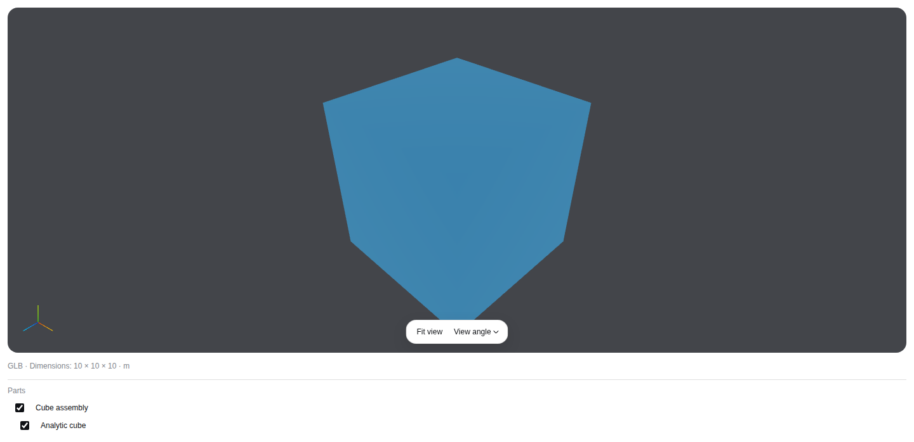
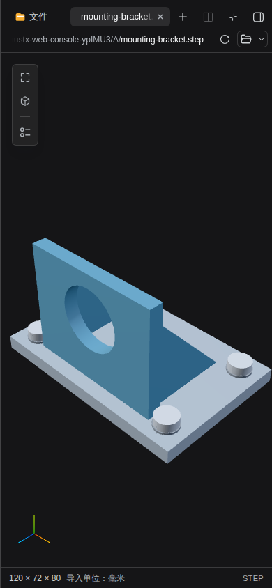

# CAD sidebar validation

Implementation baseline: `b0aa75fe110ca53a1dfc0637280f2f08508c8b7e`.
[Geometry contracts](../geometry-previews.md) define source ownership, formats and
resource limits. The [performance report](performance.md) includes the measured
environment, source/fixture digests, raw timing samples, repeated interaction
distributions, allocation accounting and Docker peak memory.

## Performance follow-up

The [performance follow-up](performance-followup.md) covers bounded camera
publication with final-pose retention, hidden-subtree picking, cached size/DPR
updates and canceled HTTP payload materialization. It includes same-host
before/after raw samples and explicitly retains the unchanged large-STL
camera bottleneck and higher sampled CAD P95 timings. The original evidence
below remains attached to its measured implementation baseline.

The follow-up passes 16 fixed-browser functional cases, including a new
synchronous camera-change burst followed by immediate hide/remount, and both
repeated large-model performance/retirement cases. The Web suite passes 4003
tests with four platform skips; final retirement-focused checks pass 117 tests.

## Executed checks

| Check | Result |
| --- | --- |
| `pnpm typecheck` | Passed |
| `pnpm build` | Passed, including native Host and production provenance/runtime checks |
| `pnpm check:provenance` | Passed: 336 source records, 344 production notices and pinned geometry assets |
| `pnpm check:i18n` | Passed |
| Focused geometry, source/copy ownership, shared document/preview, file actions and Workflow identity | 175 passed |
| Native Workbench and desktop Host contracts | 52 passed |
| Pinned browser geometry acceptance | 15 passed |
| Repeated heavy-model performance and retirement | 2 passed |
| Existing Workflow keyboard/selection/undo and screenshot reference | Passed |
| Fake-provider protocol/scenario/server suite | 94 passed |
| `cargo fmt --all -- --check` / `git diff --check` | Passed |

The local commands cover the affected browser/native seams. The complete Web and
Rust matrix is required through the PR's exact-head FULL CI profile; this is not
a claim that the entire local Web suite was rerun.

## Coverage and fixtures

The real production application opens the named twelve-part STEP/GLB assembly
through committed delivery and Workbench, using the existing App Server, Product
Host, file authority, sidebar tabs, path header and source actions. Tests exercise
short-window layout, orbit, selection/visibility, a default-collapsed tree inside
the viewport, Escape/focus return, Markdown/model tab switches, Chinese dark
narrow presentation and the file-location/application action.

Real-loader regressions reject empty or degenerate default GLB scenes even when
another scene has valid geometry, dispose every loaded scene before renderer
admission, and preserve authorized original Download. Mixed unnamed branches,
unequal depths and numeric sibling prefixes preserve actual part ancestry.

The shared browser corpus covers binary/ASCII STL, STEP including inch output,
IGES, BREP and embedded-texture GLB through both presentation entry points. It
also checks fixed-copy refresh and current-original Download, authority retirement,
split/fullscreen, keyboard menus, external-resource rejection, context loss,
late-image disposal, failed-image URL cleanup, Top/Bottom orbit restoration and
bounded retiring imports. Whole STL buffers transfer without adapter copies;
multi-group and offset views retain exact owned ranges. Position-derived bounds
and spheres remain mandatory at GPU admission.

Repeated measurements use a 735,000-vertex STL and a 96-part CAD assembly, with
five samples per action, a two-model load and zero owned resources after closing.
The software-rendered large STL has substantial measured stalls; the report
states those results and makes no hardware-GPU or universal frame-rate claim.

Fixtures and generators are original MIT-licensed data, with independent OCCT
export and analytic reference bounds described in the
[fixture manifest](../../web-console/test/fixtures/geometry/README.md).
No new production dependency or hidden parsed-model/WASM cache was added.

## Visual evidence

The compact left operator bar shares its DSH presentation module with Workflow.
The tree is inside the preview viewport and both its panel and branches begin
closed. Geometry reuses the document sidebar's existing Refresh action without a
permanent explanatory banner. Workbench defaults to opening the original file's
location and retains its application chooser.



[Expanded part tree](cad-parts.png) · [GLB in the production sidebar](cad-sidebar-glb.png) ·
[Chinese dark Workbench](cad-workbench-zh-dark.png)



[Expanded narrow part tree](cad-parts-narrow-zh-dark.png)

## Reproduction

Run the normal pinned-browser path from `web-console`:

```sh
pnpm test:e2e -- geometry.spec.ts geometry-sidebar.spec.ts geometry-performance.spec.ts
```

Docker Desktop with a separate WSL test runner can expose the exact pinned
Playwright run-server and set `RUSTX_BROWSER_WS_ENDPOINT`; the geometry tests use
native loopback forwarding. Native tests use the existing project binary and
standard supervisor paths. Neither browser references nor screenshot thresholds
were changed.

Focused adapter/content checks:

```sh
pnpm exec vitest run test/geometry-adapters.test.ts test/geometry-worker.test.ts test/geometry-view.test.tsx test/preview-content.test.ts test/geometry-evidence.test.ts test/workbench-file-actions.test.tsx
```

The [performance report](performance.md) records the measured
`575785d0c7ed29ea933ea8c07722870ba2317e26` baseline and source digests. The
admission/ancestry corner-case repairs use targeted correctness regressions;
no new performance gain is claimed. The report documents the broader sampling method
and observed limitations separately from enforceable source/output/WASM budgets.
