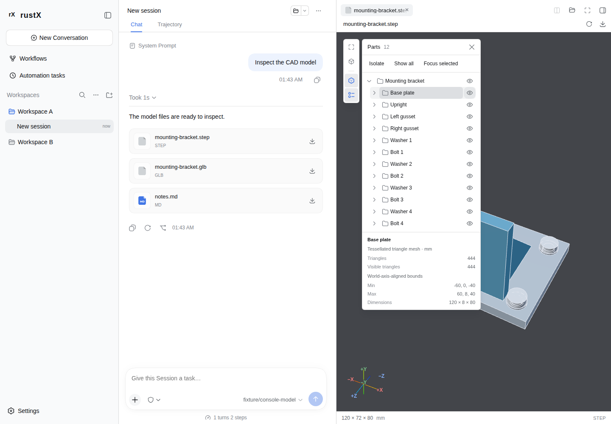

# CAD sidebar validation

[Whole-model LOD validation](lod-validation.md) records the current coarse,
medium and final tessellations, exact native equivalence and browser scope.

The first-real-mesh revision passes 4,403 Web/Host tests and 41 installed-Chrome
production functional cases. [Current phase records](first-mesh-browser-samples.json),
[orthographic coarse first model](cad-first-mesh-orthographic.png) and
[three arrow controls](geometry-arrow-controls.png) record that policy. The
installed Chrome lane is separate from pinned-container CI and large-model
performance acceptance.

Geometry previews admit up to 200 MiB through authorized, single-version byte
ranges. The first model picture uses a real complete CAD tier, with no sampled
point envelope or sparse triangle bridge. CAD refines the entire
model through coarse and medium tessellations before the final precision, using
one parsed document and one renderer/context. Every published level includes
all parts; levels replace one another instead of adding completed pieces.
New previews default to orthographic projection. Full-model moving pictures
preserve original shading and use bounded surface approximations where eligible; a
settled view restores every admitted triangle, original shading and full pixel
quality, then stops drawing. The current acceptance requirement is a usable
model picture within 200 ms and every interaction below 50 ms on the fixed
browser/test machine. The earlier 200.762-MB STEP reference passed its scoped
strict gate at revision `235559e78`; that result does not certify the new LOD
pipeline. **The complete contract across formats and model classes remains open**.

The [large STEP validation](step-200mb-validation.md) records the current
approximately 200-MB STEP workload, actual native Host and browser outcomes,
resource retirement and scope limits. STEP must meet the same first-model
and maximum-input contract as STL; the smaller 96-part assembly does not certify
large STEP performance. The
[surface-preview optimization report](surface-preview-optimization.md) retains
the same-machine comparison at `3be97a1f4` against `1d6c1e01d`, including the
approximately 200-MiB closed STL, complete draws and input maxima. The
[large-model quality report](large-model-quality.md) retains the prior revision's
measurements.
Earlier [review](review-follow-up.md), [takeover](takeover-validation.md) and
[budget](budget-follow-up.md) reports retain their named source revisions and
historical observations.
[Geometry contracts](../geometry-previews.md) define the formats, source authority,
fixed-copy lifetime, lossless preparation and resource limits.
[Interaction controls and current validation](interaction-roadmap.md) describe
isolation, focus, properties, direct axis navigation and bounded default-on
outlines. The [comment inventory](comment-status.md) lists remaining requests.
[Performance evidence at implementation 7044adafc](performance-optimization.md)
preserves the original methods and open 50/200-ms budget gap. The interaction
increment adds separate diagnostic outline costs; it does not recertify that SLA.
The earlier performance reports retain their named implementations.

## Outcome and verification

GLB, binary/ASCII STL, STEP/STP, IGES/IGS and Open CASCADE BREP open through the
shared delivery/Workbench document body. The original PBR shading and MSAA are
preserved. Exact indexing and certified planar preparation retain represented
surfaces, bounds, scale, normals/color semantics, hierarchy and original bytes.
Temporary surface approximations do not replace admitted geometry. Original PBR
materials and normals remain visible during motion. Picking intersects original
geometry, including dense opaque foregrounds. Large source buffers transfer
directly into the ready import Worker and are evicted on hide; retained small
copies keep their existing fixed-copy behavior.
No warm parsed-model/Worker/WASM-instance cache is shipped.

Historical native Host runs at `235559e78` showed a rough
picture within 200 ms, every observed coarse/fine gesture below 50 ms and all
admitted triangles after import. A coordinate envelope can omit topology,
placements and concavities; it is not the authoritative geometry. Complete
triangulation uses the unchanged CAD tolerances and the original numeric streams.
The 50-ms maximum / 200-ms first-display contract remains open for the broader
format/model matrix, including the historical large-STL first-display gap.
Native GPU completion is reported
separately from the next-rendering-opportunity proxy and the legacy display
clock; none is silently substituted for independently observed presentation.
That sampled-envelope result does not certify the current first-real-mesh gate. Earlier failing
workloads retain their original evidence and do not inherit this result.

| Historical check at fbf0a875c | Result |
| --- | --- |
| Complete Web/Host suite | 4044 passed, 4 platform skips |
| Type checking and full production application build | Passed |
| Source provenance, dependency notices and exact runtime assets/memory maximum | Passed: 336 source records, 345 notices, original pinned CAD assets |
| Product localization ownership | Passed |
| Fixed Linux browser geometry, reviews and real production sidebar | 27 passed |
| Shared document regression with the complete fixture | 5 passed |
| Separate installed Edge 156 functional/resource smoke | 21 passed |
| Two-pane outline off/on captures | 2 workloads in each browser lane |
| Explicit 50/200-ms budget gate | Prior failed acceptance retained; not relabelled by feature checks |
| Whitespace | Passed |

The latest pushed PR head requires its own selected CI checks. A prior head's CI
success is not certification of the current revision. The PR remains draft.

## Functional and fidelity coverage

The named twelve-part STEP/GLB assembly opens through the real production App
Server and Product Host with existing source authorization, sidebar tabs/path
header, Refresh, original Download and file-location/application actions.
Coverage includes orbit, pan, fit/standard views, selection/visibility, a
collapsed in-viewport part tree, Escape/focus return, Markdown/model tab changes,
short/narrow windows, Chinese/English and dark/light layouts.
Isolation/restore/show-all, small-part focus, transformed occurrence properties,
Fit/Reset, signed-axis/menu equivalence and DPR 2 navigation have dedicated
coverage. Optional outline checks include smooth surfaces, coplanar tessellation,
tiny boundaries, two panes, oversized/alpha inputs, cancellation, independent
Worker-result admission and full retirement. Camera-only metadata still causes
no React part-tree update.

Fixtures and independent analytic/OCCT references cover unit conversion,
unitless BREP/STL, embedded GLB textures, authored hierarchy/transforms and
materials. GLB admission independently checks the selected scene and actual
position-derived bounds/spheres, with complete cleanup on rejection. The existing
external-resource, malformed/oversized, decode-failure, context-loss, source
retirement, copy/Refresh and current-original Download cases remain enforced.

New regressions cover a 992,016-vertex closed STL through the actual Worker and
its original deadline; a tiny disconnected zero-normal cube; curved/thin closed
surfaces; holes/colors/reverse winding/overlaps; unused indexed coordinates;
and floating-point cancellation that otherwise erases a tiny attached surface.
The real coordinator/lease regression exercises final-pose retirement at full
two-pane capacity, rather than relying on a capacity-free mock.

The pinned browser verifies zero idle draws and zero owned Workers, contexts,
buffers, textures and URLs after closing. Resource ceilings and CAD tolerances
remain as documented. Inactive retention and source authorization remain with
the existing owners.

## Current visual evidence

The images below are diagnostic production-sidebar captures from the pinned
Linux browser; no screenshot-comparator threshold or reference was changed.



[Curved mesh silhouettes](interaction-silhouette.png) ·
[Chinese dark Workbench](interaction-structure-zh-dark.png)

Earlier captures remain with their historical measurement reports.

## Reproduction

From web-console:

```sh
pnpm typecheck
pnpm test
pnpm build
pnpm check:i18n
pnpm check:provenance
pnpm test:e2e -- geometry.spec.ts geometry-review.spec.ts geometry-roadmap.spec.ts geometry-sidebar.spec.ts workbench-documents.spec.ts
```

The native-filesystem validation copy uses the same source bytes, locked
libraries and native binary. The [performance report](performance-optimization.md)
describes the prior production-fixture/native-source lanes and their limitations.
The [interaction report](interaction-roadmap.md) defines the separate outline
cost captures and their production/complete-fixture requirements.
Fixture origins and generators are recorded in the
[fixture manifest](../../web-console/test/fixtures/geometry/README.md).
