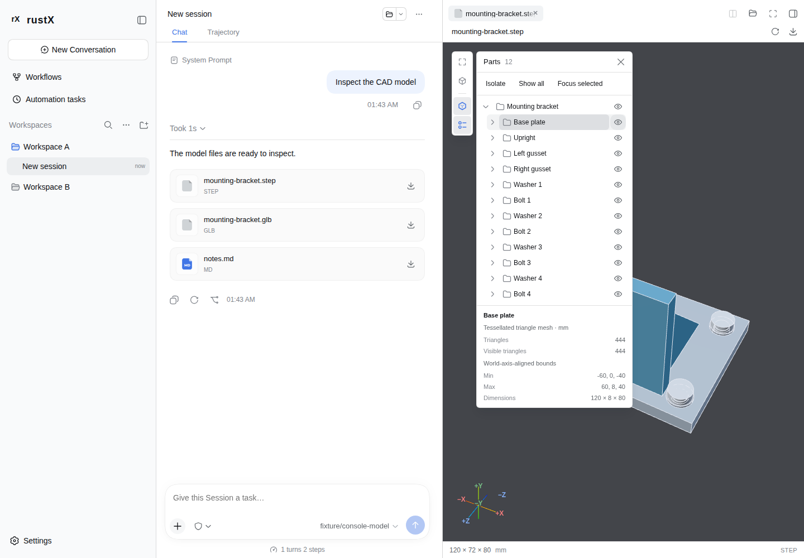
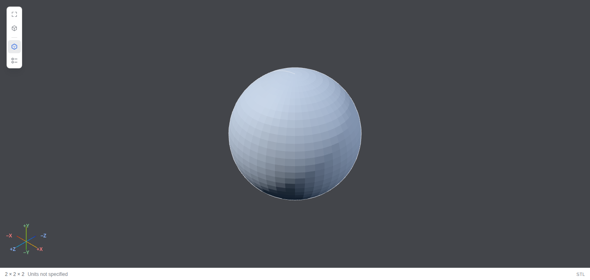

# Geometry inspection controls

Implementation: `fbf0a875c27f2b39529793fb032919eb56940797`.
Validated on 2026-11-04, Asia/Shanghai. This increment implements the recommended
PR scope of the [interaction roadmap](https://github.com/Caismis/rustX/pull/517#issuecomment-6593794843)
and its [outline/view-navigation requirements](https://github.com/Caismis/rustX/pull/517#issuecomment-6599073494).
The [geometry contract](../geometry-previews.md) owns limits and lifetime rules.
[Raw captures](interaction-roadmap-samples.json) and
[environment/source/image hashes](interaction-roadmap-environment.json) identify
the evidence. The previously recorded 50/200-ms latency gap remains open; these
feature checks do not certify that SLA.

## Implemented behavior

Both delivery and Workbench use the same View and Parts controls inside the
existing document sidebar. File authority, Refresh, original Download and
location/application actions retain their owners. There are no additional source
reads or model imports when changing the camera, selection, visibility or outline mode.

- **Fit** frames visible model content while preserving direction. **Reset view**
  restores the original full-model isometric framing without changing visibility.
- **Isolate** shows the selected occurrence, its descendants and its ancestors,
  including a selection previously hidden by an ancestor. Re-isolating another
  selection retains one original visibility snapshot. **Exit isolation** restores
  that snapshot; **Show all** deliberately clears it. Operations are batched.
- **Focus selected** uses transformed visible bounds in display-centered space,
  preserves direction and supports small occurrences without a whole-model zoom
  floor. Hidden selections cannot be focused. Compatible remounts restore the
  camera, isolation and outline preference; a new content copy resets them.
- **Properties** show admitted/visible triangle counts, known units and world-axis-
  aligned min/max/dimensions before display centering. They count repeated mesh
  occurrences and update on selection/structure changes, rather than camera
  events. Hidden-ancestor state is explained beside local visibility controls.
- Every standard-view menu item has a distinct orientation icon and localized
  name. Axis lines and signed labels directly use the menu's camera path, with
  keyboard activation on the same indicator. Labels stay separate at poles and
  after resize/DPR changes. Their activation does not pick a part or start an orbit.
- Unit captions show only the applicable symbol/name, such as mm or 毫米. STEP
  and IGES still use explicit millimeter output; source-unit inference is unchanged.



[Narrow Chinese dark Workbench](interaction-structure-zh-dark.png).

## Optional mesh outlines

Outlines start enabled and retain an explicit off preference for the current
copy. They keep the original shaded meshes, materials, normals, MSAA and source
buffers. A disposable Worker builds exact-position adjacency after import settles.
One-pixel line buffers include open/non-manifold boundaries,
30-degree creases and view-dependent silhouette candidates. Coplanar interior
tessellation disappears; smooth-surface edges are shown only when adjacent faces
cross the view-facing boundary. The overlay follows occurrence transforms and
ancestor visibility, and is excluded from picking.

These lines describe the admitted triangle mesh, not exact CAD topology. Open
seams/non-manifold inputs can produce boundary lines. Translucent or alpha-tested
models keep their original shaded view because a texture-aware outline method
is outside this increment. No source material is overridden to approximate it.

Preparation admits at most 100,000 unique input triangles and 16 MiB of copied
positions/indices. Output, including repeated occurrences, is limited to 65,536
segments and 256 extra draws per body. Packed line buffers use at most 5 MiB per
body, with at most two line materials and no render targets. The Worker has a
two-second parent deadline; packing/receiver validation yield cooperatively.
Inputs and outputs have independent checks. There is at most one import or
outline Worker per body, two aggregate.

Disable, hide, replacement, close and context loss release optional work and
graphics. Failure/limit messages preserve the usable shaded view and authorized
original Download. A 992,016-vertex closed STL proves this rejection path.



## Diagnostic outline cost

Each lane uses one fresh page per workload, two models, viewport 1440 x 1000,
DPR 1 and a 716 x 654 target canvas. After initial default-on setup, five complete
eight-step drags plus two rAFs are measured per explicit off/on phase, resetting
to Isometric before each phase. This is not a cold outline-startup distribution.
Percentiles use nearest rank, so P95 is the maximum of five. Values below are
milliseconds and include Playwright forwarding/actionability. They are not
per-event display latency, a first-open benchmark or statistical speedup proof.

| Lane / workload | Outline off P50 / P95 | Outline on P50 / P95 |
| --- | ---: | ---: |
| Chromium 153 / SwiftShader, planar outline envelope | 199.6 / 201.4 | 200.4 / 216.5 |
| Chromium 153 / SwiftShader, 96-part STEP | 583.6 / 629.2 | 778.9 / 900.2 |
| Installed Edge 156 / RTX 5080 D3D11, planar outline envelope | 220.0 / 220.8 | 220.5 / 221.1 |
| Installed Edge 156 / RTX 5080 D3D11, 96-part STEP | 218.7 / 220.5 | 220.1 / 221.0 |

Software CAD rendering has a substantial outline cost. The default-on option can
be turned off explicitly. Small differences in the other five-sample pairs
establish no speedup. The fixed Linux browser has two CPU equivalents and a 2-GiB container
limit; the installed Edge lane has unrestricted host CPU and no imposed memory
quota. Its exact installed version is 156.0.4314.58. It is a separate smoke and
hardware diagnostic lane, not screenshot-reference authority.

The planar input has 290,400 vertices / 96,800 triangles, 96.8% of the outline
input ceiling, and lossless preparation reduces the captured surface to four
outline segments / 320 bytes. The 96-part model produces 13,440 segments /
1,075,200 bytes. Each second pane is the analytic GLB cube: twelve segments /
960 bytes. Both lanes preserve MSAA. Mode preparation's button-to-logical-ready
observations span 68.6-173.8 ms, including actionability/readiness polling; they
do not observe GPU completion or physical presentation.

Both panes own exactly two contexts, no idle draws during the one-second check,
and zero Workers, contexts, buffers, textures and URLs after closing. The dedicated
fixed-browser container's cumulative peak across preliminary and final
functional/capture/document runs
was 1,295,929,344 bytes (about 1.21 GiB), with zero OOM events. This includes its
server/page cache and is not a per-model, Worker-heap, browser-RSS or GPU-memory
claim. No memory reduction against older reports is inferred.

## Verification and next scope

- Complete Web/Host suite: **4044 passed, 4 platform skips**.
- Pinned geometry, review and real-sidebar cases: **27 passed**; shared-document
  cases with their complete fixture: **5 passed**, 32 unique cases total.
- Separate installed Edge functional/resource lane: **21 passed**. Two outline
  capture cases per lane additionally verify identical initial camera policy.
- Type checking, full production build, localization, provenance (336 source
  records / 345 notices), exact unchanged CAD runtime assets and whitespace pass.
  The 17 changed/new TS/TSX/CSS files match the native-filesystem validation copy.
- The pushed head requires its own CI. PR #517 remains draft.

From web-console, run the ordinary type/build/i18n/provenance checks and:

```sh
pnpm test
pnpm test:e2e -- geometry.spec.ts geometry-review.spec.ts geometry-roadmap.spec.ts geometry-sidebar.spec.ts workbench-documents.spec.ts
```

The captured production-fixture lane separately builds `test/geometry.vite.config.ts`
and serves its output with the geometry fixture files copied into
`test/fixtures/geometry/`. Keep the application preview available for lazy-startup
checks. Shared-document tests require the complete `test/workbench.vite.config.ts`
fixture and loopback forwarding, not the geometry-only production output.
The original timing/screenshot thresholds are unchanged.

Orthographic projection needs a separately validated camera/state increment.
The [comment inventory](comment-status.md) identifies outstanding PR requests,
including the side-question sidebar and file-change hover layout.
Sectioning and mesh measurements remain P1 follow-ups with coordinate, clipping,
picking and approximation contracts. Search/filtering, explosion, synchronized
dual views and version comparison remain P2. Arbitrary transparency/background
controls and a redundant ViewCube are not added without the roadmap's stated
need and resource/quality evidence. No empty or disabled future groups are shown.
