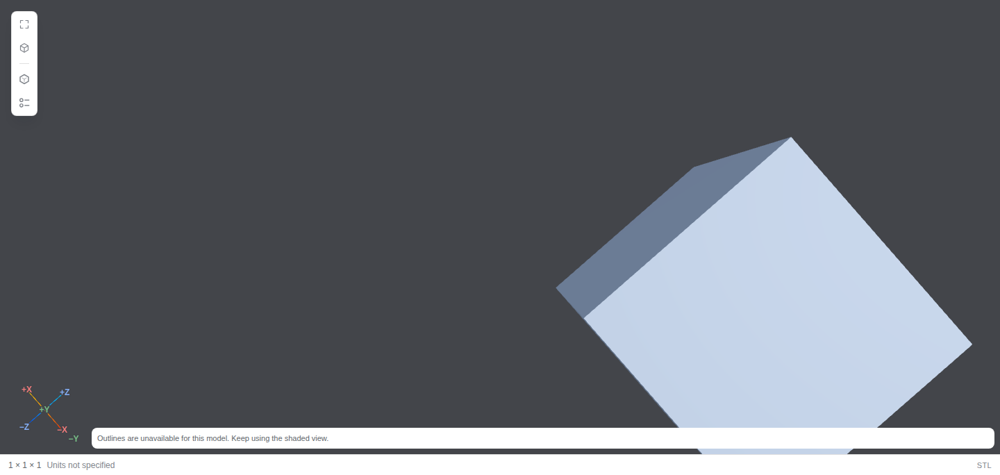

# Large geometry display quality and latency

The reference workload is approximately 200 MiB of geometry on the fixed project
browser and test machine. First demand must produce a usable model picture in
at most 200 ms, and every interaction must stay below 50 ms. Initial and moving
pictures may lose detail. After loading and interaction settle, all admitted
geometry, original shading and full pixel quality must return. Resource use must
remain bounded and idle views must stop drawing. **The complete latency contract
is still unmet; the PR remains draft.**

## Implementation

```text
authorized 2-MiB ranges -> complete single-version source copy, at most 200 MiB
  -> existing GLB loader or disposable STL/CAD Worker -> validated original mesh
      -> bounded initial/moving samples and low-resolution display
      -> complete original mesh/materials after 120 ms without interaction
```

The geometry reader allocates one exact-size destination, checks every range's
version, total size, offset, response length and EOF, and publishes only a complete
copy. Cancellation starts no next range and retains the current read's physical
settlement barrier. Managed Artifacts, ordinary complete reads and original
Download keep their existing limits. A 200-MiB geometry copy exceeds the inactive
64-MiB cache and is evicted when hidden. Authorization and Refresh semantics are
unchanged; there is no parsed-model cache or extra native read endpoint.

Display samples contain at most 20,256 triangles and 729,216 position bytes per
body, with one shared unlit material and DPR at most 0.25. Repeated occurrences
share their geometry sample. Sampling and approximate picking restore all source
geometry/material references synchronously, including after submission errors.
Selection boxes retain their original color and the axes keep their CSS hit
areas. Pending size, DPR and quality changes allocate the drawing buffer only
when a draw needs it. No initial full-resolution buffer is allocated merely to
discard it before the coarse frame.

After the gesture and quiet delay, the renderer draws every admitted triangle
with original normals, colors, textures and materials, restores the ordinary DPR
policy and draws no further frames until something changes. Unchanged gestures
schedule no refinement. Samples and their material are disposed at retirement.
Settled fidelity is relative to the admitted static mesh; CAD retains its existing
OCCT triangulation tolerances and original source bytes.

Source admission is 200 MiB, with independent limits of 13 million vertices,
5 million rendered triangles and 512 MiB decoded buffers per visible body.
Optional exact indexing/planar preparation remains restricted to one million
vertices and one million triangles, preserving its previous temporary workspace
bound. Larger meshes retain their original arrays instead of allocating expanded
hash/edge tables. The [geometry contract](../geometry-previews.md) specifies
aggregate budgets and the distinction between admission limits and actual RSS.

## Measured budget

Three fresh contexts per workload use Playwright 1.63.0, pinned Chromium 153 /
SwiftShader, DPR 1, a 1440-by-1000 viewport and the AMD Ryzen 7 9800X3D test host.
No builds or tests run alongside the performance captures. Every context records
at least 80 trusted orbit and pan samples, GPU fence completion and the next
animation-frame opportunity. This is a proxy for display, not independently
observed compositor/physical presentation. The first-model clock remains separate
from later refinement, outline readiness, screenshots and idle settlement.

| Workload | First model opportunity, ms | Orbit maximum, ms | Pan maximum, ms |
| --- | ---: | ---: | ---: |
| 735,000-vertex STL plane | 310.3–326.7 | 30.6–32.1 | 33.3–33.4 |
| 96-part STEP | 829.8–893.9 | 45.1–48.7 | 38.7–66.2 |
| Approximately 200-MiB closed STL | 996.1–1006.9 | 54.0–64.0 | 43.5–105.9 |

The large source is **209,568,684 bytes**, with **4,191,372 triangles** and
**12,574,116 vertices**. Each capture independently checks that the Worker retains
every triangle and that the settled GPU draw commands submit all 4,191,372.
Settled shading at the final measured camera pose is shown below. All nine captures record zero draws during the
settled idle second and zero owned Workers, contexts, buffers, textures and URLs
after closing. The strict gate fails all nine captures on first display; some
input maxima also exceed 50 ms. P95 remains diagnostic and is not substituted for
the maximum requirement.



The dedicated browser container peaks at **1,476,526,080 bytes** (about 1.38 GiB),
with zero OOM events/kills. Its post-capture charge is 196,624,384 bytes. These
figures include fixture storage and the browser process tree, exclude Node/Vite
and native hosts, and do not attribute individual Workers or graphics-driver
memory. The browser-host fixture holds the generated source before the clock;
real native filesystem and HTTP transfer latency are not certified. No before/
after RSS reduction is claimed from this single final run.

[Every sample and import phase](large-model-quality-samples.json) and
[tested source hashes, runtime and environment](large-model-quality-environment.json)
retain the evidence. Browser contexts are fresh; process, OS and driver caches
are not independently reset between contexts.

## Remaining loading work

The first picture still waits for a complete raw source, importer initialization,
whole-model import and receiver/scene validation. The stock OCCT interface returns
its result after its synchronous read. Lowering render quality cannot remove
these costs. The measurements therefore require further loading/import work
before the first-display contract can pass; the current implementation supplies
no early authorized geometry representation.

A relevant established pattern is Speckle's compact per-version viewer artifact
and geometry stream alongside the full artifact download. This is a design
reference for further work, not an implemented rustX source contract.
[Speckle's viewer loading description](https://speckle.systems/updates/speckle-ai-a-new-3d-viewer-new-integrations-and-more/)
documents that separation. The current implementation uses public
[Three.js geometry APIs](https://threejs.org/docs/pages/BufferGeometry.html)
and retains client parsing/render ownership and the existing authority boundaries.

## Validation and reproduction

The complete Web/Host suite passes **4,159 tests**, with four platform skips.
Type checking, full Vite application and production-fixture builds, 336 source
provenance records, 345 dependency notices, unchanged runtime assets/2-GiB WASM
maximum and localization checks pass. All **44 pinned-browser functional cases**
pass, covering formats, copy ownership, cancel/refresh, controls, thin-part depth
occlusion, DPR, two panes and retirement. Pixel, buffer and idle assertions wait
for complete quality; their existing comparison and zero-work requirements remain.
The original first-model and input latency clocks do not use those waits.

The GPU counter distinguishes the count argument of non-indexed `drawArrays`
from indexed `drawElements`; a mistaken zero count from the earlier diagnostic
attempt is not treated as missing geometry or as a completed performance sample.
Physical read assertions count the actual bounded ranges rather than assuming a
large source still uses one complete transfer.

Use the [production-fixture setup](production-fixture-benchmark.md) and run:

```sh
RUSTX_BROWSER_WS_ENDPOINT=ws://127.0.0.1:5277/ RUSTX_GEOMETRY_BUDGET=1 \
  bash web-console/scripts/geometry-performance.sh geometry-latency.spec.ts
```

The command preserves the nine raw captures before enforcing the unchanged
200-ms first-model and strict below-50-ms maximum-input thresholds. The normal
functional suite does not relabel this failing acceptance gate as passing.
The pushed revision requires its own CI results.
