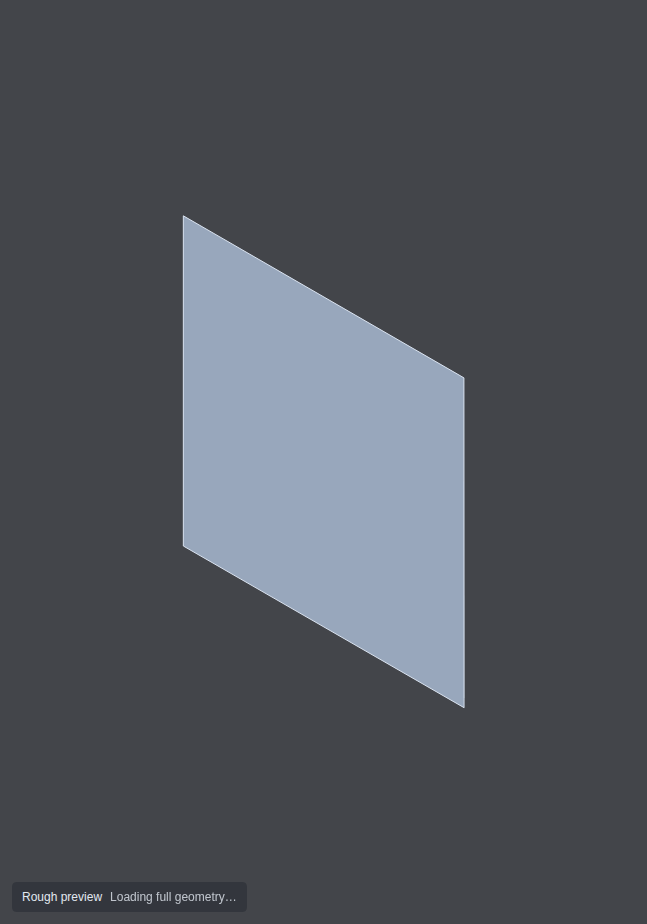
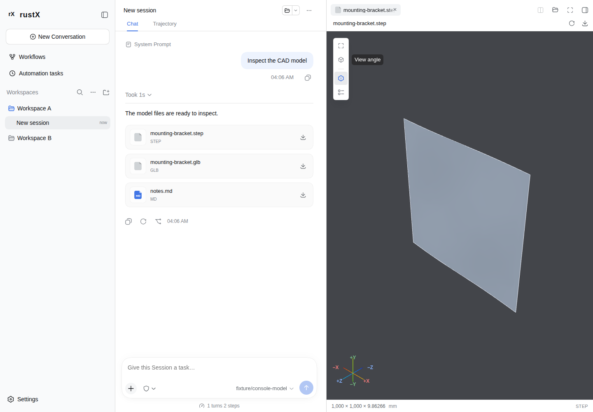

# Approximately 200 MB STEP: first picture, complete geometry and resources

## Requirement and outcome

On the existing fixed browser/test machine, opening approximately 200 MB of
geometry must show a usable source-derived picture within 200 ms, keep every
observed interaction below 50 ms, and restore complete admitted geometry when
quiet. Temporary quality loss is allowed. Original source bytes and configured
CAD import precision remain unchanged; resource ownership stays bounded.

The 200,761,968-byte STEP reference passes three independent native Host runs
and three production-fixture runs. Native first picture is
**61.9–62.5 ms**; observed coarse/fine maxima are
**35.8 / 33.9 ms**.
The complete native-path mesh arrives in 33.3–34.8 s.
These are separate clocks. The initial picture is a labeled coordinate
envelope, not the admitted CAD mesh. General STEP assemblies and the broader
format/model matrix remain uncertified; PR #517 stays draft.

## Source and measurement

Recorded on 2026-11-05 (Asia/Shanghai). The original MIT generator creates one degree-three curved B-spline face with
2,102,500 referenced poles (1450 per axis), in millimeters. Every pole belongs
to the face; no padding, unused entities or repeated comments inflate the file.
The source is 200.762 decimal MB / 191.462 MiB, within the 200-MiB admission cap.
It exercises large source parsing with a small final tessellation, rather than
a multi-part assembly or many-faceted CAD workload. The generated file stays
outside Git. SHA-256:

`0bcf7e5313f6b770cd7028360ddb5a88312c3ee8a22c1892421d366bdcf6f81b`

The machine is AMD Ryzen 7 9800X3D / Windows with WSL2, using the repository's
pinned Playwright 1.63.0 Chromium 153 / SwiftShader image, 1440×1000, DPR 1,
without an explicit CPU or memory quota. Runs are sequential with no concurrent
builds/tests. Browser contexts are fresh; OS filesystem/code caches are not
explicitly flushed. Test-machine/image details and 78 matching source/build metadata hashes
are in [the environment record](step-200mb-environment.json).

The native lane opens an actual committed delivery in the production application
through App Server, Product Host authorization and native filesystem/range
transport. It does not preload source bytes into a browser fixture. The clock
starts at trusted Preview pointerdown in an already loaded application; it
excludes browser/application/server startup. SVG first picture is a nonempty
source-derived path followed by two animation-frame opportunities. The full
mesh clock retains actual model submission, GPU-fence completion and next-frame
opportunity. Neither endpoint observes compositor/physical display presentation.

| Lane, three fresh contexts | First rough picture | First fine mesh | Maximum rough input | Maximum fine input |
| --- | --- | --- | --- | --- |
| Native Host / production application | 61.9–62.5 ms | 33.3–34.8 s | 35.8 ms | 33.9 ms |
| Production component fixture | 30.4–36.0 ms | 23.5–23.8 s | 33.5 ms | 35.5 ms |

Each run contains 100 trusted coarse and 100 trusted fine pointer-move samples.
The native gestures alternate direction to retain a visible model; the fixture
retains its original cumulative gestures. Both check the maximum, not P95.
Every settled run draws all 216 imported triangles and returns Worker, context,
buffer, texture and URL counts to zero on close. The fixture's source exists in
memory before demand, so it cannot substitute for the native transport result.
Raw arrays: [native](step-200mb-native-samples.json),
[fixture](step-200mb-samples.json).

## Implementation and display quality

The first authorized STEP range is 32 KiB, followed by at most four 32-KiB
windows. At most 128 finite CARTESIAN_POINT coordinates per window form a
projected convex envelope. The first noncollinear projection draws immediately;
later samples improve its extent. This path retains at most 640 points /
7,680 bytes and needs no Three.js, Worker or WebGL context. Offset, source
version, total size, length and EOF must agree across every physical read.
No degenerate sample becomes a placeholder model.

The envelope can omit holes, concavities and disconnected parts, include control
or construction coordinates, and does not apply assembly placements, topology
or materials. It is explicitly labeled Rough preview and supplies no picking,
engineering measurements or authoritative model metadata. This reference's
thin surface is visually close to its envelope; that is not a universal quality
bound. A complex assembly still needs its own acceptance source and visual proof.

Complete source reading continues in bounded ranges with cooperative task
yields. A fresh range already authorizes access, so native watch registration
follows the complete copy. Hidden retained copies still reauthorize before reuse.
Errors, version mismatch, retirement and cancellation fence provisional data;
an incomplete hidden copy is evicted. Physical read permits remain owned until
transport settlement.

The full-view bootstrap starts after source completion and 120 ms without rough
input. This avoids CAD download/compilation competing with first probes and
initial engine setup interrupting an active rough gesture. Once admitted, CAD
continues in its disposable Worker. Rough camera gestures seed normalized
direction, target and zoom. The envelope remains until the full mesh's first
GPU-ready draw, then retires. Full CAD has a 60-second parent deadline; STL and
immutable code fetch retain 15 seconds. These import deadlines do not relax the
200-ms first-picture or below-50-ms input gate.

The local occt-import-js 0.0.23-rustx.1 build changes only its Embind interface:
bulk numeric input, fixed 4096-double output chunks, release of exclusively owned
JS input after native copy, and release of the native input vector before mesh
extraction. It keeps upstream -Oz, allocator, geometry algorithms, numeric order,
CAD tolerances, exceptions and 2-GiB WASM maximum. Complete modified C++, pinned
revisions, licenses and rebuild instructions ship alongside the binary in
`cad-runtime-source/`. Asset/source hashes are checked during builds.

The adapter validates values while copying into typed arrays, independently
of the receiver's numeric admission. CAD face metadata has its own one-million
face cap. Equal base colors need no draw group, adjacent equal face colors
coalesce, and gaps/alternating colors preserve the separate 512-draw limit.
Manual outlines now share the surface/import retirement barrier and retain the
latest Off preference. If optional surface preparation times out, moving views
keep their bounded shaded bridge; settled draws and picking use original geometry.

## Fidelity and resource evidence

The full reference output retains 118 vertices and 216 triangles with identical
position/normal/index stream digest before and after the transfer build:

`8101630ecc9f59c3a50c4a4f38c1113af605857f7c329ff00fadc3d0355ced72`

Configured CAD triangulation remains bounding_box_ratio 0.001 / angular 0.5,
with millimeter output. Complete display adds no further mesh loss relative to
that original import result; this is not an analytic-NURBS exact-display claim.
Six small independent STEP/inch/IGES/BREP/assembly fixtures also retain complete
JSON and rendered-stream digests in the native differential harness.

One isolated sequential full-completion Node Worker comparison, with the same
source and a diagnostic 60-second deadline, records:

| Native diagnostic | Upstream SDK | Bounded-transfer SDK |
| --- | --- | --- |
| Read/import call | 40.88 s | 21.60 s |
| Process peak RSS | 1,412,984 KiB | 1,292,024 KiB |

That pair reduces import time by 47.2% and process RSS by
8.6%.
It is one diagnostic pair, not a statistical confidence interval or a UI clock.
Process RSS includes Worker and input allocations, not per-Worker attribution.
WASM exported memory remains 1,053,491,200 bytes; freeing buffers does not shrink its
grown linear memory. Worker retirement releases the instance.

The dedicated completed three-context fixture browser container peaks at
1,919,152,128 bytes, with no OOM/kill. This includes fixture storage,
network forwarding, browser/renderer/cache, and excludes Node/native Host and
external driver storage. It is not a memory-reduction comparison to an old
15-second timeout or a hard RSS budget.

## Regression and remaining limits

- Full Web/Host suite: 4,205 passed, four platform skips. Type checking, both
  production builds, localization, 336 provenance records, 346 production
  notices, pinned runtime assets and production source offer pass.
- Native and fixture strict STEP gates each pass three contexts. All 43
  production-fixture functional cases pass. Five development/native-source
  regressions pass, including the three previously failing CI scenarios and
  both original production sidebar/Workbench cases. Rust formatting and
  whitespace checks pass. Current-head CI is tracked separately after push.
- Source/version races, physical cancellation, provisional retirement, deferred
  watch setup, quiet bootstrap through sampling/drag/keyboard input, normalized
  handoff, CAD buffer ownership, face-color batching and pending-outline
  serialization have deterministic regressions.

The validation install changed from the registry SDK to the local build. Its
old Vite cache still pointed at registry 0.0.23 glue while the URL import served
the new WASM, producing a development-only LinkError. Rebuilding that development
cache with Vite's force option made the cancellation/reopen case pass. This is
an environment repair, not a measured production speedup or an independent
explanation of the previous immutable CI failure. Both exact assets remain
checked by the runtime manifest.

[Before-runtime samples](step-200mb-before-samples.json) retain three
15-second failures with the stock SDK and the new typed adapter; that variant
is not an immutable 3be97a1f4 baseline. [Before-quiet samples](step-200mb-before-quiet-samples.json)
retain the intermediate strict input failures (59.2–67.1 ms): first picture was
fast, but engine setup overlapped rough input. They are not accepted results.
Earlier [large-STL/surface measurements](surface-preview-optimization.md) keep
their named revision and unresolved first-display gap; smaller CAD fixtures or
this single-surface STEP cannot certify a different model class. No threshold,
screenshot reference or CAD precision was weakened to mark this reference green.

Reproduction, including native Host setup and the source-path opt-in, is in
[the benchmark instructions](production-fixture-benchmark.md).

