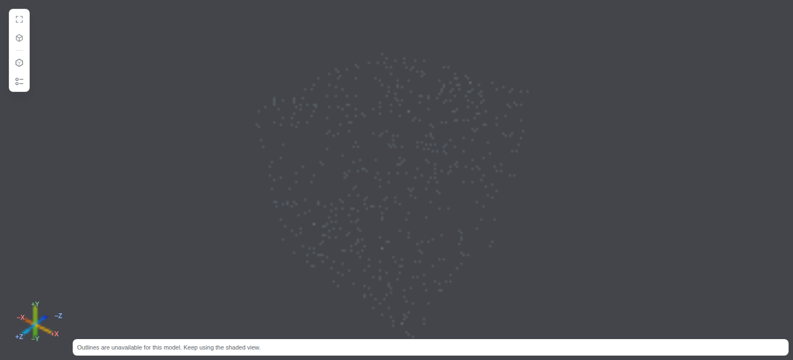
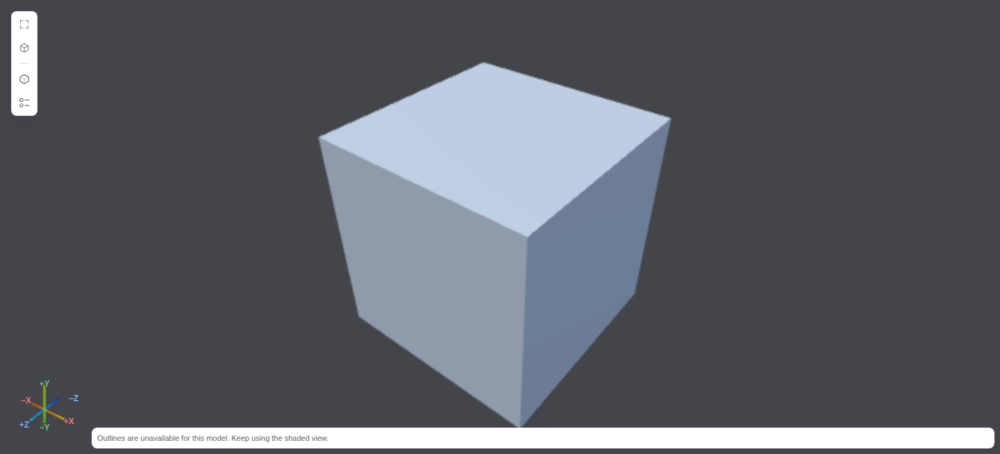

# Surface preview and import optimization

The approximately 200-MiB contract requires a usable model within 200 ms, every
interaction below 50 ms, complete admitted geometry after settling, and reduced
resource use on the project's fixed browser/test machine. **The complete contract
remains unmet: first display still exceeds 200 ms.** Functional checks and CI do
not certify the performance gate. PR #517 remains draft.

This report covers the implementation in its containing commit. The
[source manifest and environment](surface-preview-environment.json) identify the
exact tested source bytes. The comparison baseline is
`1d6c1e01dafef37b2e682d841e94273e2f073881`; its earlier report remains
[revision-specific historical evidence](large-model-quality.md).

## Implementation

Generated-model reception now combines numeric validation and bounds derivation
in one scan. Every stream, including unreferenced meshes, remains independently
admitted before graphics upload. Large STL skips redundant Worker-side numeric
scans only when its size already excludes exact optional preparation. Native
simplification cannot start until receiver admission and the first GPU fence
complete. The original import deadline remains authoritative.

The content owner transfers a raw source larger than the 64-MiB inactive cache
directly to the ready STL/CAD Worker. This removes one source-sized allocation
and copy. Small fixed copies retain their existing cache behavior. Large GLB raw
bytes are released after successful admission. Hide evicts a relinquished copy;
reopening reauthorizes and rereads it. Download remains independently authorized.

Explicit CAD demand overlaps immutable code compilation with the source read.
Demand-owned context creation and trusted three-vertex PBR shader preparation
overlap import, without submitting a model draw. Every early failure, cancellation
and context loss releases those resources under the existing two-owner cap.
Input changes submit the coalesced pose at the microtask checkpoint, avoiding an
extra animation-frame wait. Only one GPU submission/fence can be pending.

Motion preserves original PBR materials and authored normals instead of using
one unlit color. Its DPR ceiling increases from 0.25 to 0.5. Eligible generated
meshes receive an optional meshoptimizer 1.1.1 surface representation, with locked
borders, relative error at most 0.002 and a one-CSS-pixel projected error guard.
Colored/material-seamed meshes and authored GLB retain their original geometry.
The original mesh is used when the approximation is unavailable or exceeds the
projected error limit. All settled frames use complete admitted geometry,
original attributes/materials and full pixel policy.

Large binary STL is decoded into fixed 786,432-vertex chunks in the existing
import Worker. The join preserves exact position/normal tuples and removes
internal chunk-border redundancy. Other jobs copy at most 16 MiB of input.
Optional output is capped at 200,000 unique triangles / 20 MiB including source
vertex provenance, and has a two-second budget within the import deadline.
Receiver checks enforce backing sizes, source float bits, extents and finite
reported error. A sparse, shaded bridge exists only while this optional job is
pending. It is discarded on completion or timeout. Mesh outlines pause during
motion and return with the complete frame after 120 ms of quiet.

Small generated assemblies use Three.js `mergeGeometries` to combine at least
four identity occurrences sharing an opaque material. All positions, normals,
indices and triangles remain intact; combined input is capped at 16 MiB.
The 96-part fixture reduces model draws from approximately 96 to four per frame.
Hidden, transformed or changed occurrences keep their original draw path. Draw
batches attach only during synchronous submission and restore the source graph
in `finally`.

Picking always intersects original geometry. It therefore preserves opaque
foreground occlusion independently of the displayed approximation. The real
Raycaster regression first reproduced missing foreground hits, then passed all
50 triangle-centroid rays in both moving and complete modes. This addresses
[comment 6636090073](https://github.com/Caismis/rustX/pull/517#issuecomment-6636090073).

## Browser comparison

Three fresh contexts per workload use the same pinned Playwright 1.63.0 /
Chromium 153 / SwiftShader container on the AMD Ryzen 7 9800X3D machine, with
1440 × 1000 viewport, DPR 1 and MSAA. Each version starts with a restarted browser
container; no concurrent builds or tests run during measurement. The fixture
holds its source before demand, then exercises actual authorized 2-MiB range
assembly. Native HTTP/filesystem transfer latency is not certified.

The clock runs from trusted input timestamps through actual model submission,
GPU-fence completion and the next animation-frame rendering opportunity. It is
a proxy, not compositor/physical presentation. No blank canvas or loading text
counts. P95 remains diagnostic; maximum latency determines interaction acceptance.
Both versions use the same current harness. The ordinary production application
and the separate `esnext` production fixtures are built independently.

Exact values and every input sample are retained in
[baseline captures](surface-preview-baseline-final-samples.json) and
[current captures](surface-preview-candidate-final-samples.json). Every capture
checks full source triangle admission, complete settled draws for the large
closed STL, zero idle draws and zero owned resources after retirement. The budget
assertions run after saving evidence and remain strict.

| Workload / implementation | First model opportunity | Orbit maximum | Pan maximum |
| --- | ---: | ---: | ---: |
| 735,000-vertex STL / baseline | 303.4–314.4 ms | 30.7–31.1 ms | 33.5–33.6 ms |
| 735,000-vertex STL / current | 297.4–330.6 ms | 31.1–33.2 ms | 33.4–33.6 ms |
| 96-part STEP / baseline | 796.9–827.8 ms | 44.3–50.3 ms | 39.5–42.8 ms |
| 96-part STEP / current | 828.5–842.7 ms | 39.2–51.3 ms | 40.4–53.0 ms |
| Approximately 200-MiB closed STL / baseline | 1030.6–1243.9 ms | 41.5–71.7 ms | 39.5–41.4 ms |
| Approximately 200-MiB closed STL / current | 677.5–708.8 ms | 36.3–39.2 ms | 33.6–33.9 ms |

Large-STL median first display falls from 1113.2 to 685.9 ms (38.4%). Its largest
observed orbit/pan delays fall from 71.7/41.4 to 39.2/33.9 ms. Every large-STL
input sample passes 50 ms, but every first-display case fails 200 ms. CAD retains
outliers above 50 ms and has no demonstrated first-display improvement. Its
original shading and doubled moving DPR cost more than the baseline's unlit
quarter-DPR samples. The complete contract fails in all nine current captures;
two CAD captures also fail maximum interaction. The implementation does not
claim all-format latency compliance.

## Fidelity and resources

The large closed STL contains 209,568,684 source bytes, 12,574,116 vertices and
4,191,372 triangles. Its optional moving surface has 12 triangles / 1,152 bytes
including provenance, while settled draws still submit all 4,191,372 original
triangles. The separate native-simplifier regression checks paired manifold
edges, signed volume and original vertex provenance on a dense closed cube.
This analytic fixture does not certify approximation quality on arbitrary CAD.

Same-view motion captures, after background preparation, show the original
sampled picture and the current surface picture:





[Baseline complete picture](surface-preview-baseline-final-complete.png) ·
[Current complete picture](surface-preview-candidate-final-complete.png)

The two complete PNG captures are byte-identical at the same post-gesture pose
(SHA-256 `cb289cb84d8c8cd44925ad3cb2128820e83cccb343f3ecbae12b91038df1d738`).
This complements the complete draw-count and source-attribute checks; it is one
fixture/pose comparison, not general image equivalence.

Container memory is measured with cgroup v2 `memory.peak` after nine captures per
version. It includes fixture source storage, browser processes and memory cache,
but excludes the Node/native Host and external GPU-driver allocation. There are
no OOM events or kills. This is one controlled browser-container comparison,
not per-Worker attribution or a guarantee for every source.

| Dedicated browser container | Peak bytes | Peak GiB | OOM / kills |
| --- | ---: | ---: | ---: |
| Baseline | 1,491,931,136 | 1.389 | 0 / 0 |
| Current | 1,284,841,472 | 1.197 | 0 / 0 |

The measured peak decreases by 207,089,664 bytes (13.9%). Independent of that
process measurement, direct raw-buffer transfer eliminates one 209,568,684-byte
allocation/copy for the large fixture. This allocation arithmetic is not an
attribution of the entire container reduction to that one change.

A whole-mesh simplification experiment was rejected after a 2,611,675,136-byte
browser-container peak. Fixed chunks keep native workspace bounded. A naive
fence-based pixel-ratio adaptation was also rejected because idle/fence timing
did not provide a reliable GPU-duration signal. Original PBR shading is retained;
temporary diffuse/unlit experiments are not shipped.

## Verification and remaining work

- 4,185 Web/Host tests pass; four platform skips.
- Type checking, full production application and fixture builds pass.
- 44 pinned-browser functional cases pass, including all formats, production
  lazy loading, selection search, projection, thin-part occlusion, two panes,
  cancellation and complete resource retirement.
- Provenance checks cover 336 source records; notices cover 346 production
  packages. The shipping OCCT assets and 2-GiB WASM maximum are unchanged.
- Product localization ownership and whitespace checks pass.
- `cargo fmt --all -- --check` passes; native Rust sources are unchanged.
- Source/Worker cancellation, large-buffer transfer and reread, independent
  numeric admission, first-GPU readiness, original materials/normals, complete
  closed-surface preparation, exact batches, hidden ancestors and foreground
  picking have regression coverage.

The large-file pipeline still waits for a complete source read and parser result
before admitting its first display. CAD cold initialization and its synchronous
read/tessellation call also remain substantial. The initial shaded bridge may
still have sparse coverage until background surface preparation completes.
Original-geometry picking preserves correctness but does not establish a
below-50-ms guarantee on every maximum-size selection. These limits remain open;
they are not replaced by successful functional tests or favorable P95 values.

Reproduce the current strict lane with a pinned browser server as documented in
[the production benchmark](production-fixture-benchmark.md):

```sh
RUSTX_BROWSER_WS_ENDPOINT=ws://127.0.0.1:5277/ RUSTX_GEOMETRY_BUDGET=1 \
  bash web-console/scripts/geometry-performance.sh
```

Retain the nonzero exit and all raw captures when first display or any observed
interaction exceeds its budget. The latest pushed head needs its own CI; prior
head success is not certification.
